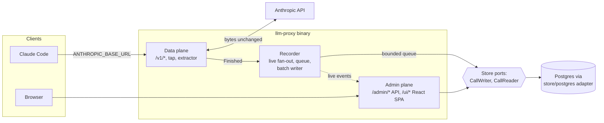

# llm-proxy architecture

Status: draft, 2026-10-20.
Companion to [`../llm-proxy-design.md`](../llm-proxy-design.md), which states the requirements (R1 to R8) and the firstmate integration. These documents describe how the system is built and run. For a conflict between sources, see [Source precedence](#source-precedence).

The goal: a self-hosted Go proxy that logs every LLM call and every tool call as metadata, so that both can be analysed later. Request and response bodies are never stored.

**v1 scope (decisions C1 to C4):** an observe-only logging proxy for the Anthropic family, with Claude Code as the day-one harness. It forwards, records and shows calls. Fallback and retries, circuit breakers, budgets, rate limits, key restrictions, alerts, OTel export, partitioning and rollups are deferred, each with a trigger for adding it back, in [backend.md, Later versions](backend.md#later-versions). The OpenAI family (Codex CLI, OpenCode) is planned for v2.

## Documents

| Document | What it covers |
|---|---|
| [backend.md](backend.md) | Go components, the proxy hot path, tap and extractor, recorder, read-time tool pairing, correlation, admin and query API, live tail, storage ports and adapters, data model, package layout, later versions |
| [frontend.md](frontend.md) | The React UI embedded in the Go binary: views, routing, data fetching, virtualization, live tail, admin access, what the UI can show without bodies, build and embedding |
| [upstream-connection.md](upstream-connection.md) | How the proxy reaches the Anthropic API with API keys, how Claude Code with a Claude subscription (Pro or Max login) can route through it, and the documented limits on that. The OpenAI family and Codex CLI setup are in its v2 section |
| [deployment.md](deployment.md) | The single-container topology, the later multi-replica tier, configuration, secrets, migrations, `store/postgres` storage and retention, sizing, backups, TLS, observability, upgrades, the docker-compose file |

Read [backend.md](backend.md) first. The other three documents assume its vocabulary.

The UI brand, Spyglass, and its palettes were chosen from the proposals in [branding-proposals.html](../branding-proposals.html) ([ADR 0053](../adrs/0053-spyglass-brand-palettes-and-theme-switching.md)).

The v1 work is broken down into architecture decision records in [`../adrs/`](../adrs/README.md), with dependencies and a suggested implementation order.

## System at a glance

1. Clients change only a base URL. The data plane forwards each request to the Anthropic API and streams the response back without buffering. Errors reach the client unchanged; the client does its own retries.
2. The request body is read once into memory, and a tap reads the response as it passes. After the exchange ends, the extractor builds one small call record and hands it to the recorder without blocking. The recorder fans it out to live-tail subscribers and puts it on a bounded queue. A full queue drops the record and counts it.
3. A batch writer hands call records in batches to the `CallWriter` store port. The `store/postgres` adapter only appends rows, idempotently. Each `tool_use` and each `tool_result` is its own row, with ids and sizes only; they are paired when read.
4. The admin plane serves a JSON API and the React UI. It has no sign-in, so it listens on loopback only. Everything it shows comes through `CallReader` from stored rows: numbers, names and hashes, never content. Sessions, agent trees, tool pairs and statistics are computed at read time.
5. Storage is behind two ports defined by use case. Only the wiring in `cmd` knows the Postgres adapter; see [backend.md](backend.md#storage-ports-and-adapters).

## Decisions this architecture builds on

Taken by the captain:

- **UI technology:** React SPA embedded in the Go binary with `go:embed`, a Go JSON API, and SSE live tail (UI design report, section 10, Q1 option a).
- **Body search: withdrawn.** The earlier choice, Postgres `tsvector` plus `pg_trgm` over call text with 14-day retention (UI design report, section 10, Q2 option a), no longer applies, because bodies are not stored.
- **Language:** the proxy is written in Go.

Taken from the reports' recommendations: a transparent same-protocol reverse proxy with an in-memory tap, and harness-header correlation. Tool-call records are paired at read time.

## Source precedence

One rule settles every disagreement between sources, in this order:

1. Landed code.
2. Completed ADRs (Status: Completed).
3. These architecture documents, for work not yet built.
4. ADRs not yet built (Accepted or Proposed).

The order ranks sources as descriptions of current behaviour. A lower source that disagrees with a higher one needs a fix. An Accepted ADR that amends landed code records the planned target: its decision wins over the code until its Work required lands, after which code and ADR agree. Stale sketches in these documents follow the code: for example, `core` defines its own `ID` and `MicroUSD` types in place of `uuid.UUID` and `decimal.Decimal`. A change to a Completed ADR is a new ADR that names the Completed one it amends; a Completed ADR is never edited ([ADR README](../adrs/README.md#status-meanings)).

## Sources

The three knowledge reports behind these documents are kept outside the repository, in firstmate's data directory:

- Requirements gap review (gaps B1 to B10, R1 to R17, N1 to N9): `firstmate/data/llm-proxy-req-gaps/report.md`
- Approach comparison (interception, storage, Go implications; its journal and projection sections are superseded): `firstmate/data/llm-proxy-approaches/report.md`
- UI design (views, filters, pagination, UI technology, gaps G1 to G13; its search-storage sections no longer apply): `firstmate/data/llm-proxy-ui-design/report.md`

The documents cite them as "gap review", "approaches report" and "UI report", with a section number. External sources are cited where they are used, mainly in [upstream-connection.md](upstream-connection.md).

## Resolved decisions

D1, D2 and D6 were open in earlier drafts. The captain decided that bodies are never stored, and that subscription passthrough is supported as an opt-in. See [backend.md, Shape](backend.md#shape). D14 records the storage boundary, and D15 moves virtual keys from the store into the config file. C1 to C4 are the answers to the simplification review of the backend design; they resolve D3, D4 and D7 and revise D14, D9 and D10. D5 and D9 to D13 were the last open decisions; the captain accepted their recommended options (rows below). C8 records the coherence review.

| # | Decision | Resolution |
|---|---|---|
| D1 | **Body-capture default** (approaches report Q1, UI report Q3, gap G12) | **Resolved: no bodies.** Request and response bodies are never stored, by default or by option. The tap extracts facts in memory and discards the bytes. Per call the store keeps who (key, client, session, agent, parent agent, prompt), model and provider, tokens (including cache read, cache write and reasoning) and cost, timings (TTFT, duration), status, error type and stop reason. Tool calls are kept as records: tool name, call id, requesting call, duration, success or error, argument size. No argument text, results or prompts |
| D2 | **Journal-first storage** (approaches report Q2) | **Resolved: direct database rows.** Call records go through a bounded in-memory queue and a batch writer straight into the store (the `store/postgres` adapter in v1). There is no journal, no projector and no reprojection. A full queue drops the record and counts it; the call is never affected |
| C1 | **v1 scope** (simplification review, option a) | **Resolved: v1 is an observe-only logging proxy.** Fallback and retries, circuit breakers, budgets, rate limits, key restrictions, alerts and OTel export are deferred, as are partitioning and rollups. Each has a trigger for adding it back in [backend.md, Later versions](backend.md#later-versions) |
| C2 | **In-memory store adapter** (revises D14, option a) | **Resolved: no `store/memory`.** The storage ports and the contract suite stay. The contract suite and the `CallReader` tests run against a real Postgres, in a container per test run. Unit tests use small fakes of the narrow ports: `CallWriter` as a slice |
| C3 | **Where providers and pricing live** (resolves D7, option a) | **Resolved: the config file.** Providers and pricing live in the config file and reload on `SIGHUP`. Virtual keys follow in D15. The UI page for providers and pricing is read-only |
| C4 | **OpenAI family in v1** (resolves D3 and D4, option b) | **Resolved: Anthropic family only in v1.** The OpenAI family (passthrough, `include_usage` handling, Codex CLI and OpenCode setup) moves to v2; see [backend.md](backend.md#openai-family-v2-decisions-c4-and-d3) and [upstream-connection.md](upstream-connection.md#later-openai-family-v2) |
| C5 | **Cache-miss diagnosis** (firstmate suggestion, captain's decision) | **Resolved: deferred out of v1.** v1 keeps the per-call cache token columns, so hit ratios stay visible, but not the reason for a miss. The segment hashing, the `call_segments` table, `CacheDiff`, the cache-analysis endpoint and the UI cache-miss view move to [backend.md, Cache-miss diagnosis](backend.md#cache-miss-diagnosis). Add them back on repeated unexplained cache misses or rising cache-write cost. v1 has two tables, `calls` and `tool_events` |
| C6 | **Model aliases and request rewriting** (firstmate suggestion, captain's decision) | **Resolved: removed from v1.** There is no route resolver, no `aliases` config section and no in-body `model` splice. Requests are forwarded exactly as sent to the single configured Anthropic provider, and the call record keeps the model the client asked for. Pricing stays. Aliases return when a second provider or central model pinning is needed; see [backend.md, Later versions](backend.md#gateway-features-decision-c1) |
| C7 | **Admin sign-in** (firstmate suggestion, captain's decision) | **Resolved: no admin sign-in in v1.** No admin token, sign-in page, `POST`/`DELETE /admin/session`, session cookie or Bearer admin-token path. To keep that safe, the admin listener binds to loopback by default and `serve` refuses to start if `listen.admin` is not a loopback address. Data-plane virtual keys are unchanged. Sign-in returns when the admin UI or API is exposed beyond localhost, or shared; see [backend.md, Later versions](backend.md#gateway-features-decision-c1) |
| D3 | **Translation scope** (gap B2, approaches report Q3) | **Resolved by C4: Anthropic-family passthrough only in v1.** No cross-family translation or fallback. An OpenAI-family passthrough is planned for v2 |
| D4 | **Day-one harnesses** (approaches report Q4) | **Resolved by C4: Claude Code only in v1** (verified against Anthropic's gateway docs). Codex CLI and OpenCode come in v2, each after a capture test of its session headers |
| D7 | **Provider and credential config location** (gap B8) | **Resolved by C3: providers, credential references and pricing in the config file.** Virtual keys were in the store in this resolution; D15 moves them into the config file |
| D14 | **Storage boundary** (firstmate proposal, then captain's request; revised by C2) | **Resolved: storage behind two ports; Postgres adapter for v1; SQLite adapter deferred.** Ports are defined by use case (`CallWriter`, `CallReader`), not generic CRUD. Virtual keys are not a storage concern since D15. The adapter owns its SQL and migrations; no shared SQL, no ORM. v1 ships `store/postgres` only, with hand-written `pgx` queries and goose migrations applied by `serve` at start. One contract suite runs against it on a real Postgres, and the suite is written so a later adapter can reuse it. Only `cmd` wiring imports `store/postgres`. A `store/sqlite` adapter for single-machine use is possible later and is not v1 scope. See [backend.md](backend.md#storage-ports-and-adapters) |
| D15 | **Where virtual keys live** (revises D7 and D14, captain's decision) | **Resolved: the config file.** The `keys` section lists each virtual key as a `name`, the `sha256` of the key and an optional `disabled` flag; the plaintext is never stored. Keys are generated outside the database (`openssl`, or `llm-proxy keygen --name <name>`). The key map is built from the config snapshot and swapped atomically on `SIGHUP`. Add, revoke and rotate are config edits plus `SIGHUP`. Call records store the key name. This removes the `KeyStore` port, the `virtual_keys` table, the key create and revoke endpoints, the key-management UI page and the write-through logic. Accepted costs: no self-service key creation in the UI, key names must stay stable for attribution, per-key usage comes from the call log grouped by key name. See [backend.md, Auth](backend.md#auth-virtual-keys) and [deployment.md, Secrets](deployment.md#secrets) |
| D6 | **Claude subscription passthrough** (captain's decision, taking the recommendation) | **Resolved: supported, opt-in, off by default.** `client_passthrough` is a per-provider `auth_mode`, fixed for the provider (there is no mode that accepts both); `proxy_key` stays the default. It is documented as the personal local setup: one person's own Claude login, one login per person, never shared, the proxy bound to `127.0.0.1`, the virtual key sent in `x-llm-proxy-key` and checked against the `keys` section of the config file. `proxy_key` with an API key is the route for heavy or shared use. The must and must-not rules, usage-limit and terms notes stay. See [upstream-connection.md](upstream-connection.md#claude-code-with-a-claude-subscription) and the worked example in [deployment.md](deployment.md#personal-local-setup-subscription-passthrough) |
| D5 | **Claude Code hint headers for firstmate crewmates** (approaches report Q5; [ADR 0042](../adrs/0042-claude-code-hint-headers-for-crewmates.md)) | **Resolved: on for crewmates.** Crewmates set `CLAUDE_CODE_GATEWAY_HINT_HEADERS=1`, so the proxy receives request class, agent type, prompt id, compaction flags and tool run times. The proxy parses the hint headers whenever they are present. Leaving them off was the rejected alternative: no agent type, no prompt id, no compaction markers, estimated tool durations. See [backend.md, Correlation](backend.md#correlation) |
| D9 | **Other blocking gaps** (gap review B1, B3 to B8, B10; [ADR 0046](../adrs/0046-adopt-gap-review-defaults.md)) | **Resolved: the gap review's suggestions,** as adjusted by C1 to C4 and listed in [backend.md, "Defaults taken for open gaps"](backend.md#defaults-taken-for-open-gaps): plain unpartitioned tables (B1), Anthropic-only passthrough (B2), model names forwarded as sent (B3), fallback (B4) and budgets (B7) deferred, `include_usage` in v2 (B6), config-file providers (B8). Each gap's own alternatives were rejected |
| D10 | **Rework and risk gaps** (gap review R1 to R17; [ADR 0046](../adrs/0046-adopt-gap-review-defaults.md)) | **Resolved: the gap review's suggestions** where these docs touch them, as adjusted by C1: key format with a SHA-256 hash in the config file and no pepper (R1), no admin auth with a loopback-only admin listener (R8), alerts deferred (R9), retention by batched `DELETE` (R10), one replica (R14), targets (R15), self-observability through `/metrics` (R16). Each gap's own alternatives were rejected |
| D11 | **Short tool snippets** (follow-up to D1; [ADR 0043](../adrs/0043-short-tool-snippets.md)) | **Resolved: keep nothing.** No tool argument text, no tool result text, no error snippet. Tool calls carry name, ids, sizes, duration and success or error only. Short snippets, for example the first 200 bytes of tool arguments and of error output, were rejected: they may hold secrets, paths or prompt text |
| D12 | **Provider error message text** (follow-up to D1; [ADR 0044](../adrs/0044-provider-error-message-text.md)) | **Resolved: error type and HTTP status only.** The message text is dropped. Keeping it was rejected: it helps debugging but may echo prompt content |
| D13 | **Opt-in per-key body capture** (follow-up to D1; [ADR 0045](../adrs/0045-opt-in-per-key-body-capture.md)) | **Resolved: no capture switch exists,** off or on. A per-key switch was rejected: it would need a body store, retention, encryption and admin sign-in again, which D1 and D2 removed |
| C8 | **Coherence review** (docs review; [ADR 0047](../adrs/0047-credential-modes-one-fixed-auth-mode-per-provider.md), [0048](../adrs/0048-call-record-and-filter-changes.md), [0049](../adrs/0049-source-precedence-and-corrections-to-completed-adrs.md)) | **Resolved:** one fixed `auth_mode` per provider (no `both`); the call record stores the mode used; no `billing_mode`; a wrong-place credential is rejected with `401`; `context_compacted` on the call record; `Endpoints` and `Streamed` on `CallFilter`; `/admin/calls` replaces `/admin/requests`; no derived session keys (a call without a session header has no session); the live tail shows finished calls only; `pricing_version` is the matched entry's `from` date; per-task key injection (ADR 0041) leaves v1; the source precedence rule above |

The search choice taken earlier (Postgres `tsvector` and `pg_trgm`, option 2a) is **withdrawn**: there is no stored text to search.

Consequences accepted with this change:

- No search over prompt or response text.
- Call detail shows numbers and tool names, not content.
- A wrong parsing or normalization rule cannot be recomputed for past rows. A fix applies to new calls.
- A process crash loses the call records still in the queue; there is no durable buffer.

Consequences of D14: there is one more layer between consumers and SQL, and the contract suite becomes the definition of correct storage behaviour. In return, `recorder`, `proxy` and `api` are testable without a database, using small fakes of the narrow ports, and a second adapter needs no consumer changes. The read-side tests need Docker or a local Postgres.

Build-or-adopt (gap B9) is treated as settled: the approaches report recommends building on the Go standard library, and these documents assume that.
