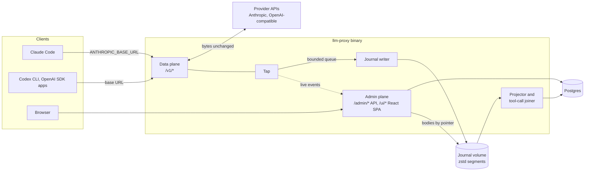

# llm-proxy architecture

Status: draft, 2026-10-20.
Companion to [`../llm-proxy-design.md`](../llm-proxy-design.md), which states the requirements (R1 to R8) and the first data model. These documents describe how the system is built and run. Where they differ from the design doc, these documents are newer, and the difference is named.

The goal: a self-hosted Go proxy that logs every LLM call and every tool call, so that both can be analysed later.

## Documents

| Document | What it covers |
|---|---|
| [backend.md](backend.md) | Go components, the proxy hot path, capture journal, projector, tool-call joiner, correlation, admin and query API, live tail, OTel export, alerts, data model changes, package layout |
| [frontend.md](frontend.md) | The React UI embedded in the Go binary: views, routing, data fetching, virtualization, body viewers, live tail, search, admin auth, build and embedding |
| [upstream-connection.md](upstream-connection.md) | How the proxy reaches provider APIs with API keys, how Claude Code with a Claude subscription (Pro or Max login) can route through it, and the documented limits on that |
| [deployment.md](deployment.md) | Single-container and multi-replica topologies, configuration, secrets, migrations, journal storage and retention, backups, TLS, observability, upgrades, a docker-compose sketch |

Read [backend.md](backend.md) first. The other three documents assume its vocabulary.

## System at a glance

1. Clients change only a base URL. The data plane forwards each request to a provider of the same protocol family and streams the response back without buffering.
2. A tap copies the raw request and response bytes. After the exchange ends, the tap hands it to a bounded queue without blocking.
3. A journal writer appends each exchange to compressed segment files. The journal is the source of truth.
4. A projector reads the journal and writes queryable rows into Postgres. It also joins each `tool_use` with its later `tool_result` into one tool-call record.
5. The admin plane serves a JSON API and the React UI. Lists and search read Postgres. Full bodies are read from the journal by pointer.

## Decisions this architecture builds on

Taken by the captain:

- **UI technology:** React SPA embedded in the Go binary with `go:embed`, a Go JSON API, and SSE live tail (UI design report, section 10, Q1 option a).
- **Body search:** Postgres `tsvector` with a GIN index over the new text of each call, plus `pg_trgm` on tool arguments, with 14-day retention (UI design report, section 10, Q2 option a).
- **Language:** the proxy is written in Go.

Taken from the reports' recommendations, and still open (see below): a transparent same-protocol reverse proxy with a raw-byte tap, a capture journal with an async Postgres projection, harness-header correlation, and joined tool-call records.

## Sources

The three knowledge reports behind these documents are kept outside the repository, in firstmate's data directory:

- Requirements gap review (gaps B1 to B10, R1 to R17, N1 to N9): `firstmate/data/llm-proxy-req-gaps/report.md`
- Approach comparison (interception, journal, projection, Go implications): `firstmate/data/llm-proxy-approaches/report.md`
- UI design (views, filters, pagination, search storage, UI technology, gaps G1 to G13): `firstmate/data/llm-proxy-ui-design/report.md`

The documents cite them as "gap review", "approaches report" and "UI report", with a section number. External sources are cited where they are used, mainly in [upstream-connection.md](upstream-connection.md).

## Open decisions

Every section that depends on one of these follows the recommended option and says so with a **Pending decision** note. Changing a decision changes only the sections that link here.

| # | Decision | Recommended (used in these docs) | Alternatives | Affects |
|---|---|---|---|---|
| D1 | **Body-capture default** (approaches report Q1, UI report Q3, gap G12) | Full request and response bodies captured by default in the journal, with a retention window and a per-key opt-out | (b) metadata only by default, bodies opt-in per key, as design doc 7.2 says today; (c) bodies always, no opt-out | [backend](backend.md#capture-journal), [frontend](frontend.md#body-capture-and-what-the-ui-can-show), [deployment](deployment.md#journal-storage-and-retention) |
| D2 | **Journal-first storage** (approaches report Q2) | Raw capture journal on disk is the source of truth; Postgres is a rebuildable projection | Write rows straight to Postgres with bodies in a `jsonb` table: simpler, but a wrong normalization rule stays wrong forever | [backend](backend.md#capture-journal), [deployment](deployment.md#journal-storage-and-retention) |
| D3 | **Translation scope** (gap B2, approaches report Q3) | Same-family passthrough only in v1: Anthropic clients to Anthropic upstreams, OpenAI clients to OpenAI-compatible upstreams. No cross-family fallback | Plan cross-format translation, which roughly multiplies the adapter work | [backend](backend.md#proxy-passthrough-and-streaming), [upstream](upstream-connection.md#protocol-families-and-endpoints) |
| D4 | **Day-one harnesses** (approaches report Q4) | Claude Code (verified against Anthropic's gateway docs). Codex CLI and OpenCode after a capture test each | Add Pi or others on day one | [backend](backend.md#correlation), [upstream](upstream-connection.md#codex-cli-and-other-openai-compatible-clients) |
| D5 | **Claude Code hint headers for firstmate crewmates** (approaches report Q5) | Set `CLAUDE_CODE_GATEWAY_HINT_HEADERS=1`, so the proxy receives request class, agent type, prompt id and tool run times | Leave them off and derive less | [backend](backend.md#correlation), [upstream](upstream-connection.md#claude-code-with-a-proxy-held-api-key) |
| D6 | **Claude subscription passthrough** (new in these docs) | Supported as an opt-in, per-provider `client_passthrough` mode, for a person's own subscription traffic only. Off by default; API-key mode is the default | Do not support subscription traffic at all; API keys only | [upstream](upstream-connection.md#claude-code-with-a-claude-subscription) |
| D7 | **Provider and credential config location** (gap B8) | Providers and credential references in the config file; virtual keys, aliases and pricing in Postgres, edited through the admin API | Everything in Postgres, with an encrypted credential column | [backend](backend.md#configuration-and-key-cache), [deployment](deployment.md#configuration) |
| D8 | **Multi-replica live tail** (UI report 8.4) | The projector sends `NOTIFY` after each commit; every replica's admin plane relays it. In-flight calls show only on the replica that serves them | The UI subscribes to every replica's stream | [backend](backend.md#live-tail), [deployment](deployment.md#topology-b-multi-replica-team-or-production) |
| D9 | **Other blocking gaps** (gap review B1, B3 to B8, B10) | The gap review's suggestions, as listed in [backend.md, "Defaults taken for open gaps"](backend.md#defaults-taken-for-open-gaps) | Each gap's own alternatives in the gap review | backend, upstream, deployment |
| D10 | **Rework and risk gaps** (gap review R1 to R17) | The gap review's suggestions where these docs touch them: key format (R1), admin auth (R8), retention (R10), team tier scope (R14), targets (R15), self-observability (R16) | Each gap's own alternatives | backend, frontend, deployment |

Build-or-adopt (gap B9) is treated as settled: the approaches report recommends building on the Go standard library, and these documents assume that.
