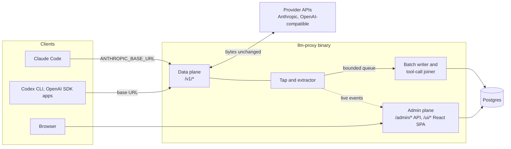

# llm-proxy architecture

Status: draft, 2026-10-20.
Companion to [`../llm-proxy-design.md`](../llm-proxy-design.md), which states the requirements (R1 to R8) and the first data model. These documents describe how the system is built and run. Where they differ from the design doc, these documents are newer, and the difference is named.

The goal: a self-hosted Go proxy that logs every LLM call and every tool call as metadata, so that both can be analysed later. Request and response bodies are never stored.

## Documents

| Document | What it covers |
|---|---|
| [backend.md](backend.md) | Go components, the proxy hot path, tap and extractor, batch writer, tool-call joiner, correlation, admin and query API, live tail, OTel export, alerts, data model changes, package layout |
| [frontend.md](frontend.md) | The React UI embedded in the Go binary: views, routing, data fetching, virtualization, live tail, admin auth, what the UI can show without bodies, build and embedding |
| [upstream-connection.md](upstream-connection.md) | How the proxy reaches provider APIs with API keys, how Claude Code with a Claude subscription (Pro or Max login) can route through it, and the documented limits on that |
| [deployment.md](deployment.md) | Single-container and multi-replica topologies, configuration, secrets, migrations, Postgres storage and retention, sizing, backups, TLS, observability, upgrades, a docker-compose sketch |

Read [backend.md](backend.md) first. The other three documents assume its vocabulary.

## System at a glance

1. Clients change only a base URL. The data plane forwards each request to a provider of the same protocol family and streams the response back without buffering.
2. A tap reads the request and response bytes in memory as they pass, extracts facts and discards the bytes. After the exchange ends, it hands one small call record to a bounded queue without blocking. A full queue drops the record and counts it.
3. A batch writer inserts call records into Postgres in batches, with idempotent inserts. It also joins each `tool_use` with its later `tool_result` into one tool-call record, using ids and sizes only.
4. The admin plane serves a JSON API and the React UI. Everything it shows comes from Postgres rows: numbers, names and hashes, never content.

## Decisions this architecture builds on

Taken by the captain:

- **UI technology:** React SPA embedded in the Go binary with `go:embed`, a Go JSON API, and SSE live tail (UI design report, section 10, Q1 option a).
- **Body search: withdrawn.** The earlier choice, Postgres `tsvector` plus `pg_trgm` over call text with 14-day retention (UI design report, section 10, Q2 option a), no longer applies, because bodies are not stored.
- **Language:** the proxy is written in Go.

Taken from the reports' recommendations, and still open (see below): a transparent same-protocol reverse proxy with an in-memory tap, harness-header correlation, and joined tool-call records.

## Sources

The three knowledge reports behind these documents are kept outside the repository, in firstmate's data directory:

- Requirements gap review (gaps B1 to B10, R1 to R17, N1 to N9): `firstmate/data/llm-proxy-req-gaps/report.md`
- Approach comparison (interception, storage, Go implications; its journal and projection sections are superseded): `firstmate/data/llm-proxy-approaches/report.md`
- UI design (views, filters, pagination, UI technology, gaps G1 to G13; its search-storage sections no longer apply): `firstmate/data/llm-proxy-ui-design/report.md`

The documents cite them as "gap review", "approaches report" and "UI report", with a section number. External sources are cited where they are used, mainly in [upstream-connection.md](upstream-connection.md).

## Resolved decisions

These two were open in earlier drafts. The captain decided that bodies are never stored. See [backend.md, Shape](backend.md#shape).

| # | Decision | Resolution |
|---|---|---|
| D1 | **Body-capture default** (approaches report Q1, UI report Q3, gap G12) | **Resolved: no bodies.** Request and response bodies are never stored, by default or by option. The tap extracts facts in memory and discards the bytes. Per call the store keeps who (key, client, session, agent, sub-agent, prompt), model, provider and route, tokens (including cache read, cache write and reasoning) and cost, timings (TTFT, duration), status, error type and stop reason, and the hash-only cache diagnosis. Tool calls are kept as records: tool name, call id, requesting call, duration, success or error, argument size. No argument text, results or prompts |
| D2 | **Journal-first storage** (approaches report Q2) | **Resolved: direct Postgres rows.** Call records go through a bounded in-memory queue and a batch writer straight into Postgres. There is no journal, no projector and no reprojection. A full queue drops the record and counts it; the call is never affected |

The search choice taken earlier (Postgres `tsvector` and `pg_trgm`, option 2a) is **withdrawn**: there is no stored text to search.

Consequences accepted with this change:

- No search over prompt or response text.
- Call detail shows numbers and tool names, not content.
- A wrong parsing or normalization rule cannot be recomputed for past rows. A fix applies to new calls.
- A process crash loses the call records still in the queue; there is no durable buffer.

## Open decisions

Every section that depends on one of these follows the recommended option and says so with a **Pending decision** note. Changing a decision changes only the sections that link here.

| # | Decision | Recommended (used in these docs) | Alternatives | Affects |
|---|---|---|---|---|
| D3 | **Translation scope** (gap B2, approaches report Q3) | Same-family passthrough only in v1: Anthropic clients to Anthropic upstreams, OpenAI clients to OpenAI-compatible upstreams. No cross-family fallback | Plan cross-format translation, which roughly multiplies the adapter work | [backend](backend.md#proxy-passthrough-and-streaming), [upstream](upstream-connection.md#protocol-families-and-endpoints) |
| D4 | **Day-one harnesses** (approaches report Q4) | Claude Code (verified against Anthropic's gateway docs). Codex CLI and OpenCode after a capture test each | Add Pi or others on day one | [backend](backend.md#correlation), [upstream](upstream-connection.md#codex-cli-and-other-openai-compatible-clients) |
| D5 | **Claude Code hint headers for firstmate crewmates** (approaches report Q5) | Set `CLAUDE_CODE_GATEWAY_HINT_HEADERS=1`, so the proxy receives request class, agent type, prompt id and tool run times | Leave them off and derive less | [backend](backend.md#correlation), [upstream](upstream-connection.md#claude-code-with-a-proxy-held-api-key) |
| D6 | **Claude subscription passthrough** (new in these docs) | Supported as an opt-in, per-provider `client_passthrough` mode, for a person's own subscription traffic only. Off by default; API-key mode is the default | Do not support subscription traffic at all; API keys only | [upstream](upstream-connection.md#claude-code-with-a-claude-subscription) |
| D7 | **Provider and credential config location** (gap B8) | Providers and credential references in the config file; virtual keys, aliases and pricing in Postgres, edited through the admin API | Everything in Postgres, with an encrypted credential column | [backend](backend.md#configuration-and-key-cache), [deployment](deployment.md#configuration) |
| D8 | **Multi-replica live tail** (UI report 8.4) | The batch writer sends `NOTIFY` after each commit; every replica's admin plane relays it. In-flight calls show only on the replica that serves them | The UI subscribes to every replica's stream | [backend](backend.md#live-tail), [deployment](deployment.md#topology-b-multi-replica-team-or-production) |
| D9 | **Other blocking gaps** (gap review B1, B3 to B8, B10) | The gap review's suggestions, as listed in [backend.md, "Defaults taken for open gaps"](backend.md#defaults-taken-for-open-gaps) | Each gap's own alternatives in the gap review | backend, upstream, deployment |
| D10 | **Rework and risk gaps** (gap review R1 to R17) | The gap review's suggestions where these docs touch them: key format (R1), admin auth (R8), retention (R10), team tier scope (R14), targets (R15), self-observability (R16) | Each gap's own alternatives | backend, frontend, deployment |
| D11 | **Short tool snippets** (follow-up to D1) | Keep nothing: no tool argument text, no tool result text, no error snippet. Tool calls carry name, ids, sizes, duration and success or error only (strict default) | Keep a short snippet, for example the first 200 bytes of tool arguments and of error output, so the tool explorer can show what ran | [backend](backend.md#extractor), [frontend](frontend.md#v4-tool-call-explorer) |
| D12 | **Provider error message text** (follow-up to D1) | Keep error type and HTTP status only; drop the message text (strict default) | Keep the provider's error message, which helps debugging but may echo prompt content | [backend](backend.md#extractor), [frontend](frontend.md#v3-call-detail) |
| D13 | **Opt-in per-key body capture** (follow-up to D1) | None: no capture switch exists, off or on (strict default) | A per-key switch, off by default, that writes bodies for chosen keys. It would need a store, retention and encryption again, which this change removes | [backend](backend.md#extractor), [deployment](deployment.md#storage-retention-and-sizing) |

Build-or-adopt (gap B9) is treated as settled: the approaches report recommends building on the Go standard library, and these documents assume that.
