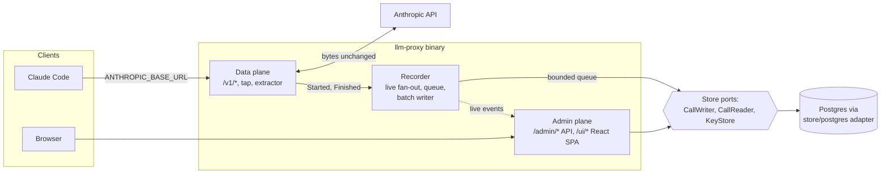

# llm-proxy architecture

Status: draft, 2026-10-20.
Companion to [`../llm-proxy-design.md`](../llm-proxy-design.md), which states the requirements (R1 to R8) and the first data model. These documents describe how the system is built and run. Where they differ from the design doc, these documents are newer, and the difference is named.

The goal: a self-hosted Go proxy that logs every LLM call and every tool call as metadata, so that both can be analysed later. Request and response bodies are never stored.

**v1 scope (decisions C1 to C4):** an observe-only logging proxy for the Anthropic family, with Claude Code as the day-one harness. It forwards, records and shows calls. Fallback and retries, circuit breakers, budgets, rate limits, key restrictions, alerts, OTel export, partitioning and rollups are deferred, each with a trigger for adding it back, in [backend.md, Later versions](backend.md#later-versions). The OpenAI family (Codex CLI, OpenCode) is planned for v2.

## Documents

| Document | What it covers |
|---|---|
| [backend.md](backend.md) | Go components, the proxy hot path, tap and extractor, recorder, read-time tool pairing, correlation, admin and query API, live tail, storage ports and adapters, data model, package layout, later versions |
| [frontend.md](frontend.md) | The React UI embedded in the Go binary: views, routing, data fetching, virtualization, live tail, admin auth, what the UI can show without bodies, build and embedding |
| [upstream-connection.md](upstream-connection.md) | How the proxy reaches the Anthropic API with API keys, how Claude Code with a Claude subscription (Pro or Max login) can route through it, and the documented limits on that. The OpenAI family and Codex CLI setup are in its v2 section |
| [deployment.md](deployment.md) | The single-container topology, the later multi-replica tier, configuration, secrets, migrations, `store/postgres` storage and retention, sizing, backups, TLS, observability, upgrades, a docker-compose sketch |

Read [backend.md](backend.md) first. The other three documents assume its vocabulary.

## System at a glance

1. Clients change only a base URL. The data plane forwards each request to the Anthropic API and streams the response back without buffering. Errors reach the client unchanged; the client does its own retries.
2. The request body is read once into memory, and a tap reads the response as it passes. After the exchange ends, the extractor builds one small call record and hands it to the recorder without blocking. The recorder fans it out to live-tail subscribers and puts it on a bounded queue. A full queue drops the record and counts it.
3. A batch writer hands call records in batches to the `CallWriter` store port. The `store/postgres` adapter only appends rows, idempotently. Each `tool_use` and each `tool_result` is its own row, with ids and sizes only; they are paired when read.
4. The admin plane serves a JSON API and the React UI. Everything it shows comes through `CallReader` from stored rows: numbers, names and hashes, never content. Sessions, agent trees, tool pairs and statistics are computed at read time.
5. Storage is behind three ports defined by use case. Only the wiring in `cmd` knows the Postgres adapter; see [backend.md](backend.md#storage-ports-and-adapters).

## Decisions this architecture builds on

Taken by the captain:

- **UI technology:** React SPA embedded in the Go binary with `go:embed`, a Go JSON API, and SSE live tail (UI design report, section 10, Q1 option a).
- **Body search: withdrawn.** The earlier choice, Postgres `tsvector` plus `pg_trgm` over call text with 14-day retention (UI design report, section 10, Q2 option a), no longer applies, because bodies are not stored.
- **Language:** the proxy is written in Go.

Taken from the reports' recommendations, and still open (see below): a transparent same-protocol reverse proxy with an in-memory tap, and harness-header correlation. Tool-call records are paired at read time.

## Sources

The three knowledge reports behind these documents are kept outside the repository, in firstmate's data directory:

- Requirements gap review (gaps B1 to B10, R1 to R17, N1 to N9): `firstmate/data/llm-proxy-req-gaps/report.md`
- Approach comparison (interception, storage, Go implications; its journal and projection sections are superseded): `firstmate/data/llm-proxy-approaches/report.md`
- UI design (views, filters, pagination, UI technology, gaps G1 to G13; its search-storage sections no longer apply): `firstmate/data/llm-proxy-ui-design/report.md`

The documents cite them as "gap review", "approaches report" and "UI report", with a section number. External sources are cited where they are used, mainly in [upstream-connection.md](upstream-connection.md).

## Resolved decisions

D1 and D2 were open in earlier drafts. The captain decided that bodies are never stored. See [backend.md, Shape](backend.md#shape). D14 records the storage boundary. C1 to C4 are the answers to the simplification review of the backend design; they resolve D3, D4 and D7 and revise D14, D9 and D10.

| # | Decision | Resolution |
|---|---|---|
| D1 | **Body-capture default** (approaches report Q1, UI report Q3, gap G12) | **Resolved: no bodies.** Request and response bodies are never stored, by default or by option. The tap extracts facts in memory and discards the bytes. Per call the store keeps who (key, client, session, agent, sub-agent, prompt), model, provider and route, tokens (including cache read, cache write and reasoning) and cost, timings (TTFT, duration), status, error type and stop reason, and the hash-only cache diagnosis. Tool calls are kept as records: tool name, call id, requesting call, duration, success or error, argument size. No argument text, results or prompts |
| D2 | **Journal-first storage** (approaches report Q2) | **Resolved: direct database rows.** Call records go through a bounded in-memory queue and a batch writer straight into the store (the `store/postgres` adapter in v1). There is no journal, no projector and no reprojection. A full queue drops the record and counts it; the call is never affected |
| C1 | **v1 scope** (simplification review, option a) | **Resolved: v1 is an observe-only logging proxy.** Fallback and retries, circuit breakers, budgets, rate limits, key restrictions, alerts and OTel export are deferred, as are partitioning and rollups. Each has a trigger for adding it back in [backend.md, Later versions](backend.md#later-versions) |
| C2 | **In-memory store adapter** (revises D14, option a) | **Resolved: no `store/memory`.** The storage ports and the contract suite stay. The contract suite and the `CallReader` tests run against a real Postgres, in a container per test run. Unit tests use small fakes of the narrow ports: `CallWriter` as a slice, `KeyStore` as a map |
| C3 | **Where aliases and pricing live** (resolves D7, option a) | **Resolved: the config file.** Providers, aliases and pricing live in the config file and reload on `SIGHUP`. Only virtual keys are in the database. The UI pages for aliases and pricing are read-only |
| C4 | **OpenAI family in v1** (resolves D3 and D4, option b) | **Resolved: Anthropic family only in v1.** The OpenAI family (passthrough, `include_usage` handling, Codex CLI and OpenCode setup) moves to v2; see [backend.md](backend.md#openai-family-v2-decisions-c4-and-d3) and [upstream-connection.md](upstream-connection.md#later-openai-family-v2) |
| D3 | **Translation scope** (gap B2, approaches report Q3) | **Resolved by C4: Anthropic-family passthrough only in v1.** No cross-family translation or fallback. An OpenAI-family passthrough is planned for v2 |
| D4 | **Day-one harnesses** (approaches report Q4) | **Resolved by C4: Claude Code only in v1** (verified against Anthropic's gateway docs). Codex CLI and OpenCode come in v2, each after a capture test of its session headers |
| D7 | **Provider and credential config location** (gap B8) | **Resolved by C3: providers, credential references, aliases and pricing in the config file.** Virtual keys in the store (`KeyStore`, Postgres in v1), edited through the admin API |
| D14 | **Storage boundary** (firstmate proposal, then captain's request; revised by C2) | **Resolved: storage behind three ports; Postgres adapter for v1; SQLite adapter deferred.** Ports are defined by use case (`CallWriter`, `CallReader`, `KeyStore`), not generic CRUD. The adapter owns its SQL and migrations; no shared SQL, no ORM. v1 ships `store/postgres` only, with hand-written `pgx` queries and goose migrations applied by `serve` at start. One contract suite runs against it on a real Postgres, and the suite is written so a later adapter can reuse it. Only `cmd` wiring imports `store/postgres`. A `store/sqlite` adapter for single-machine use is possible later and is not v1 scope. See [backend.md](backend.md#storage-ports-and-adapters) |

The search choice taken earlier (Postgres `tsvector` and `pg_trgm`, option 2a) is **withdrawn**: there is no stored text to search.

Consequences accepted with this change:

- No search over prompt or response text.
- Call detail shows numbers and tool names, not content.
- A wrong parsing or normalization rule cannot be recomputed for past rows. A fix applies to new calls.
- A process crash loses the call records still in the queue; there is no durable buffer.

Consequences of D14: there is one more layer between consumers and SQL, and the contract suite becomes the definition of correct storage behaviour. In return, `recorder`, `keyring`, `proxy` and `api` are testable without a database, using small fakes of the narrow ports, and a second adapter needs no consumer changes. The read-side tests need Docker or a local Postgres.

## Open decisions

Every section that depends on one of these follows the recommended option and says so with a **Pending decision** note. Changing a decision changes only the sections that link here.

| # | Decision | Recommended (used in these docs) | Alternatives | Affects |
|---|---|---|---|---|
| D5 | **Claude Code hint headers for firstmate crewmates** (approaches report Q5) | Set `CLAUDE_CODE_GATEWAY_HINT_HEADERS=1`, so the proxy receives request class, agent type, prompt id and tool run times | Leave them off and derive less | [backend](backend.md#correlation), [upstream](upstream-connection.md#claude-code-with-a-proxy-held-api-key) |
| D6 | **Claude subscription passthrough** (new in these docs) | Supported as an opt-in, per-provider `client_passthrough` mode, for a person's own subscription traffic only. Off by default; API-key mode is the default | Do not support subscription traffic at all; API keys only | [upstream](upstream-connection.md#claude-code-with-a-claude-subscription) |
| D8 | **Multi-replica live tail** (UI report 8.4). Not v1: v1 runs one replica | When the multi-replica tier is built, a `LiveFeed` port delivers committed calls (`store/postgres`: `NOTIFY` after each commit) and every replica's admin plane relays it. In-flight calls show only on the replica that serves them | The UI subscribes to every replica's stream | [backend](backend.md#storage-and-scale), [deployment](deployment.md#later-multi-replica-tier) |
| D9 | **Other blocking gaps** (gap review B1, B3 to B8, B10) | The gap review's suggestions, as adjusted by C1 to C4 and listed in [backend.md, "Defaults taken for open gaps"](backend.md#defaults-taken-for-open-gaps): plain unpartitioned tables (B1), Anthropic-only passthrough (B2), unmapped model names pass through (B3), fallback (B4) and budgets (B7) deferred, `include_usage` in v2 (B6), config-file providers (B8) | Each gap's own alternatives in the gap review | backend, upstream, deployment |
| D10 | **Rework and risk gaps** (gap review R1 to R17) | The gap review's suggestions where these docs touch them, as adjusted by C1: key format with a SHA-256 hash and no pepper (R1), one admin token (R8), alerts deferred (R9), retention by batched `DELETE` (R10), one replica (R14), targets (R15), self-observability through `/metrics` (R16) | Each gap's own alternatives | backend, frontend, deployment |
| D11 | **Short tool snippets** (follow-up to D1) | Keep nothing: no tool argument text, no tool result text, no error snippet. Tool calls carry name, ids, sizes, duration and success or error only (strict default) | Keep a short snippet, for example the first 200 bytes of tool arguments and of error output, so the tool explorer can show what ran | [backend](backend.md#extractor), [frontend](frontend.md#v4-tool-call-explorer) |
| D12 | **Provider error message text** (follow-up to D1) | Keep error type and HTTP status only; drop the message text (strict default) | Keep the provider's error message, which helps debugging but may echo prompt content | [backend](backend.md#extractor), [frontend](frontend.md#v3-call-detail) |
| D13 | **Opt-in per-key body capture** (follow-up to D1) | None: no capture switch exists, off or on (strict default) | A per-key switch, off by default, that writes bodies for chosen keys. It would need a store, retention and encryption again, which this change removes | [backend](backend.md#extractor), [deployment](deployment.md#storage-retention-and-sizing) |

Build-or-adopt (gap B9) is treated as settled: the approaches report recommends building on the Go standard library, and these documents assume that.
