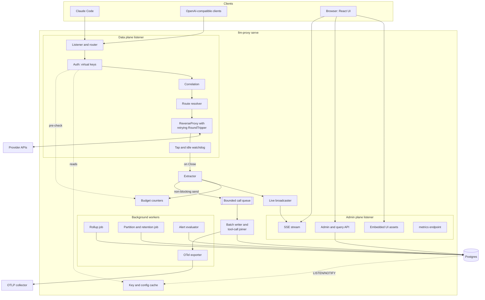
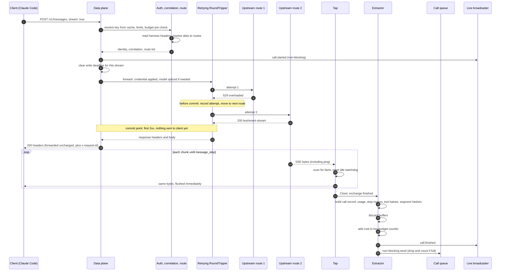

# Backend architecture (Go)

Part of the [architecture set](README.md). Upstream credentials and Claude subscription routing are in [upstream-connection.md](upstream-connection.md). The UI that consumes the admin API is in [frontend.md](frontend.md). How the binary is deployed is in [deployment.md](deployment.md).

## Shape

One Go module, one static binary, `llm-proxy`, with subcommands:

| Subcommand | Purpose |
|---|---|
| `serve` | Runs the data plane, the admin plane, the batch writer and the background jobs |
| `migrate up` / `migrate status` | Applies the embedded Postgres migrations |
| `keys create` / `keys revoke` | Bootstrap virtual keys and admin tokens from the command line, before the UI exists |

**Storage model.** The proxy never stores request or response bodies. The tap reads each exchange in memory, the extractor keeps a small set of facts (who, route, tokens, cost, timings, outcome, cache hashes, tool-call metadata), and the batch writer inserts them into Postgres as rows. There is no capture journal and no body table. Consequences: no search over prompt or response text, call detail shows numbers and tool names but not content, and a wrong parsing rule cannot be recomputed for past rows; a fix applies to new calls only. This resolves decisions D1 and D2 ([README](README.md#resolved-decisions)).

The binary has two listeners, so the data plane and the admin plane can be exposed and authenticated separately (design doc 6.1, gap review R8):

| Listener | Default address | Serves |
|---|---|---|
| Data plane | `:8080` | `/v1/*` provider-compatible endpoints, `HEAD /api/hello`, `/healthz`, `/readyz` |
| Admin plane | `:9090` | `/admin/*` JSON API and SSE, `/ui/*` embedded React SPA, `/metrics`, `/healthz`, `/readyz` |

## Component diagram



Two properties hold for every arrow out of the data plane:

- **The hot path never waits on storage.** Nothing between the client and the upstream reads or writes Postgres. Auth and routing read an in-memory cache. Budget checks read an in-process counter.
- **Logging never fails a request.** A full queue drops the call record and increments a counter. A failed batch write is retried, logged and counted. A Postgres outage fills the queue, and records past its capacity are dropped and counted.

## Components

### Listener and router

- `net/http` server with the standard `ServeMux` and method patterns (Go 1.22 and later). No web framework (gap review B10, approaches report section 8).
- Server timeouts: set `ReadHeaderTimeout` and `IdleTimeout`. **Do not set a global `WriteTimeout`**: it cuts long SSE streams. The approaches report measured this (section 6, finding 4). Each streaming request clears its own write deadline with `http.NewResponseController(w).SetWriteDeadline(time.Time{})`.
- Request size limit: 32 MiB per request body (gap review R15), enforced with `http.MaxBytesReader`.
- Every response carries `x-request-id`, a UUIDv7 that is also the primary id of the call. A client-supplied `x-request-id` is kept as `client_request_id`, never reused as the id (gap review R17).
- Middleware order: recover, request id, access log (`log/slog`, with header redaction in one place), auth, correlation, route.
- Graceful shutdown on SIGTERM: stop accepting connections, wait for in-flight streams up to a drain deadline (default 10 minutes, gap review R14), close the queue, and let the batch writer drain it into Postgres within a flush deadline (default 30 seconds). Records still queued after the deadline are counted as dropped and their number is logged.

### Auth (virtual keys)

- **Virtual keys** look like `lp_<base62 of 32 random bytes>`. Postgres stores only an HMAC-SHA256 of the key with a server pepper, plus a display prefix of `lp_` and 4 characters (gap review R1). The plaintext is shown once at creation.
- **Where the key is read from.** In the default `proxy_key` mode the client sends its virtual key as its API credential: `Authorization: Bearer lp_…` or `x-api-key: lp_…`. In `client_passthrough` mode the client's own credential occupies `Authorization`, so the virtual key travels in a separate `x-llm-proxy-key` header. [upstream-connection.md](upstream-connection.md#credential-modes) explains both modes. The proxy consumes `x-llm-proxy-key` and never forwards it.
- **Lookup** is an in-memory map from HMAC to key record, loaded at start and refreshed by Postgres `LISTEN/NOTIFY` on key changes, with a 30-second TTL backstop. Revocation therefore reaches every replica within 30 seconds at worst.
- **Checks**, in order: key exists, not expired, not revoked, alias or model allowed, requests-per-minute and concurrency limits, budget pre-check. A failure returns a protocol-correct error body for the client's family (Anthropic or OpenAI shape) with a stable `type` per error class (gap review R3), and `retry-after` in integer seconds on 429.
- **Budget enforcement is soft** (gap review B7). The extractor adds each call's cost to an in-process atomic counter per key. The pre-check reads that counter, so overshoot is bounded by the calls in flight. In the multi-replica tier the counter becomes a Postgres counter row; see [deployment.md](deployment.md#shared-state-in-the-multi-replica-tier).
- **Admin plane auth** is separate: admin tokens with scope `admin` or `read`, stored hashed like virtual keys (gap review R8). The browser exchanges a token for a session cookie; see [frontend.md](frontend.md#authentication-to-the-admin-api).

### Correlation

The correlation step reads harness headers into the call record. It never parses the body.

| Field | Source, in priority order |
|---|---|
| `session_key` | `x-claude-code-session-id`; then Codex and OpenCode session headers (`session-id`, `x-session-affinity`, `x-session-id`, `thread-id`, `conversation_id`); then a generic `x-session-id`; otherwise empty, and the batch writer derives one |
| `agent_id`, `parent_agent_id` | `x-claude-code-agent-id`, `x-claude-code-parent-agent-id` |
| `agent_type` | `x-claude-code-agent-type` (hint header) |
| `prompt_id` | `x-claude-code-prompt-id` (hint header) |
| `request_class` | `x-claude-code-request-class`: `main`, `subagent`, `workflow`, `compaction`, `auxiliary` (hint header) |
| `compaction`, `context_compacted` | `x-claude-code-compaction`, `x-claude-code-context-compacted` (hint headers) |
| `prev_tool_durations` | `x-claude-code-prev-tool-durations`, raw value; parsed by the extractor (hint header) |
| `trace_id` | W3C `traceparent` |
| `client`, `client_raw` | `User-Agent` normalized to its product token (`claude-cli/2.1.290` becomes `claude-cli`), raw value kept (gap review R17) |

- The Claude Code header names and semantics come from Anthropic's [gateway compatibility guide](https://code.claude.com/docs/en/llm-gateway-protocol). The session and agent IDs are always sent. The rows marked "hint header" arrive behind a custom base URL only when the client sets `CLAUDE_CODE_GATEWAY_HINT_HEADERS=1`. **Pending decision D5** in the [README](README.md#open-decisions): set it for firstmate crewmates (recommended).
- The Codex and OpenCode header names are known only from Bifrost's source, not from vendor docs (approaches report 2.3). Each needs a capture test before it is relied on. **Pending decision D4.**
- Correlation headers are forwarded upstream unchanged, so the proxy stays transparent.
- Session derivation, when no session header is present, happens in the batch writer, not on the hot path: hash of (key, client, tools and system segment hash, hash of the first user message), with a 30-minute idle timeout (gap review R5). Only hashes are used; no message text is kept.

### Route resolver

- The client's `model` value is looked up as an alias. An alias name may equal a vendor model id, so `claude-opus-4-8` can be an alias (gap review B3). Unmapped names are rejected with a protocol-correct 404, unless the key has an opt-in passthrough provider.
- An alias maps to an ordered list of routes `(provider, model, params)`. Every route of an alias must be in the client's protocol family (**pending decision D3**: same-family only in v1).
- The route list is snapshotted per request, so an alias edit never changes a request in flight (gap review R2).
- When the route's model differs from the client's value, the proxy splices the new value into the body bytes with `tidwall/sjson` `SetBytes`. It never decodes and re-encodes the body. Re-encoding would break prompt caching, the attribution-block strip and the preserved-thinking checks that Anthropic's gateway guide describes.
- In `client_passthrough` mode the resolver allows only routes to the provider the client's credential belongs to. Alias rewriting and fallback are off there; see [upstream-connection.md](upstream-connection.md#what-the-proxy-must-and-must-not-do-in-passthrough-mode).

### Proxy passthrough and streaming

Built on `net/http/httputil.ReverseProxy`. The approaches report verified the relevant behavior with an experiment (section 6): immediate flushing of `text/event-stream`, cancellation propagation, body closing on client abort, and no measurable added latency.

- **`Rewrite`** sets the upstream URL from the route, applies the credential mode (replace the client credential with the provider key, or pass it through), removes `x-llm-proxy-key`, and splices `model` when needed. All other headers and body bytes are forwarded unchanged. `anthropic-version`, `anthropic-beta` and every other `anthropic-*` header are forwarded as open lists, as Anthropic's guide requires.
- **`Transport`** is a retrying `http.RoundTripper`. Before the commit point it may retry the same route or move to the next one on 429, 5xx, a connect timeout or a response-header timeout. Every try is recorded as an attempt with its upstream request id.
- **Commit point:** the first upstream response with a 2xx status, before any byte is written to the client (gap review B4, approaches report 7.2). After commit there is no retry. A mid-stream upstream error passes through to the client as it arrives.
- When every route fails, the client receives the last upstream status and body unmodified, plus `x-request-id` (gap review R3). Claude Code's retry logic matches on the upstream's error wording, so error bodies are never wrapped.
- **Response headers** pass through unchanged, in particular `content-type`, `retry-after`, `x-should-retry` and `anthropic-ratelimit-unified-*`. The upstream's own request id header is stored as `upstream_request_id`.
- **OpenAI-family streams:** the proxy injects `stream_options.include_usage=true` when the client did not set it, and strips the extra usage chunk from the client stream in that case (gap review B6, LiteLLM precedent). This is the only hot-path body edit, and only for OpenAI-family requests.
- **Upstream timeouts:** a `net.Dialer` timeout, `Transport.ResponseHeaderTimeout` for time to headers, and an idle-between-chunks watchdog in the tap. SSE `ping` events are never stripped: during long thinking pauses they are the only bytes on the stream.
- **Client abort:** the upstream request uses the client's context, so an abort cancels upstream (gap review R4). The call is still logged, with the facts extracted so far, `error_class = client_abort` and `usage_estimated = true`.
- **Upstream transport:** HTTP/2 to providers by default, keep-alives on, connection pool sized per provider.

### Tap

The tap reads the stream in memory, extracts facts and discards the bytes. No body is written to disk or to Postgres.

- `ModifyResponse` wraps the upstream response body in a tap. `Read` passes each chunk to an incremental scanner and forwards it unchanged, then resets the idle watchdog. For SSE it splits events on blank lines and keeps only the facts below. For a non-streaming JSON response it buffers up to the size bound, then parses once.
- The request body is read the same way, through a tee into a per-exchange buffer. The extractor needs the whole request to hash prompt segments; the buffer is released as soon as extraction ends.
- Buffers are bounded (default 32 MiB for the request, 1 MiB for one SSE event). Past a bound the tap stops reading that part, keeps forwarding, and sets `extraction_partial = true` on the record. Fields it could not read stay null.
- Buffers come from a `sync.Pool` and return to it after extraction. Nothing keeps a reference to a body after that.
- `Close` is the "exchange finished" hook. `ReverseProxy` closes the upstream body on success, on upstream error and on client abort, so the hook is reliable.
- The tap measured 54 µs in total for a whole 5-event stream in the approaches report's experiment. That figure covered copying only; the cost of incremental scanning is a phase-1 measurement.

### Extractor

The only component that understands provider formats. It runs in its own goroutine after `Close`, off the hot path, and turns one exchange into one **call record**. Pure functions per protocol family (`anthropic`, `openai`), golden-tested against recorded SSE fixtures.

A call record holds:

- **Who:** virtual key, client, session key, agent and parent agent, agent type, prompt id (all from headers, see [Correlation](#correlation)).
- **What ran:** alias, route, final provider and model, attempts with upstream request ids.
- **Usage and cost:** tokens normalized into disjoint columns (input, cache read, cache write, output, reasoning), the raw provider usage JSON (gap review B6), and cost from the versioned `pricing` table with the pricing version.
- **Timings:** time to first byte, TTFT, total duration, and for tool-call duration the start and end timestamps.
- **Outcome:** HTTP status, `error_class`, the provider's error `type` (for example `overloaded_error`), stop reason, `streamed`, `usage_estimated`, `extraction_partial`. The provider's error message text is not kept.
- **Cache diagnosis:** hashes of cumulative prompt segments (design doc 5.1; canonical form per gap review R6), computed over the request in memory. Only hashes and token estimates leave the extractor.
- **Tool halves:** for each `tool_use` block (Anthropic) or `tool_calls[]` entry (OpenAI) in the response: the provider call id, tool name and argument size in bytes. For each `tool_result` block or `role: "tool"` message in the request: the call id it answers, `is_error` and the result size in bytes. Argument text and result text are read to measure them and are not kept. No snippet, no prompt text and no header value other than the correlation fields above is stored; credentials are never read into the record. In `client_passthrough` mode the client's OAuth token is never written anywhere; see [upstream-connection.md](upstream-connection.md#what-the-proxy-must-and-must-not-do-in-passthrough-mode).

**Pending decisions D11 to D13** ([README](README.md#open-decisions)) would relax the strict reading: short tool argument and error snippets (D11), provider error message text (D12), and an opt-in per-key body capture switch (D13). The default is the strict option for all three: none of that is kept.

After building the record the extractor:

1. Adds the cost to the key's budget counter.
2. Publishes `call.finished` to the live broadcaster.
3. Sends the record to the bounded queue with a non-blocking `select`. When the queue is full it drops the record and increments `llm_proxy_calls_dropped_total`.

### Batch writer

One or more goroutines receive call records from the queue and write them straight to Postgres. There is no intermediate store: the queue is the only buffer.

- **Batching:** a batch closes at `writer.batch_rows` records or `writer.batch_interval`, whichever comes first (defaults 1000 rows, 500 ms).
- **Write path:** `pgx` `CopyFrom` into per-batch staging tables, then `INSERT … ON CONFLICT DO NOTHING` into `requests`, `request_attempts` and `request_segments`, then the tool-call upserts and the `sessions` and `agents` updates, all in one transaction. The call id is a UUIDv7 assigned at request start, so a retried batch inserts nothing twice (gap review B5).
- **Failure:** a failed batch is retried with backoff and counted (`llm_proxy_writer_errors_total`). While Postgres is down the queue fills; the extractor then drops and counts new records. The data plane never notices. A crash loses the queue contents, at most `queue_capacity` records; this is the accepted cost of having no durable buffer.
- **Drop counting:** every dropped record increments `llm_proxy_calls_dropped_total` with a `reason` label (`queue_full`, `shutdown`). The alert evaluator raises an alert when the count is above zero.
- **Session derivation:** when no session header was present, the writer derives the session from hashes (see [Correlation](#correlation)) and updates `sessions` and `agents`, including the inferred link from a sub-agent to the `Task` tool call that spawned it (UI report 3.2, gap G2).
- **Shutdown:** on SIGTERM, after in-flight streams finish or the drain deadline passes, the queue is closed and the writer flushes what remains, then exits. See [Listener and router](#listener-and-router).
- **Live tail:** after each commit the writer sends `NOTIFY llm_proxy_calls` with the call ids (multi-replica live tail, pending decision D8).
- **OTel:** the writer hands committed records to the OTel exporter ([OTel export](#otel-export)).

### Tool-call joiner

A proxy never sees a tool run. It sees the model request the tool in response N, and the client return the result in request N+1, linked by the tool-call id (approaches report section 3). The joiner works from the tool halves in call records and keeps metadata only.

- A `tool_use` half inserts a `tool_calls` row: id, tool name, provider call id, requesting call, agent, prompt, argument size, `status = pending`.
- A `tool_result` half in a later request updates that row with `is_error`, the result size, the resolving call id and the duration. The update is keyed by `(session_key, tool_call_id)` and only touches rows still pending, so it is idempotent.
- The joiner runs inside the batch writer's transaction. No argument text, no result text and no snippet of either is stored (see [Data model changes](#data-model-changes)).
- **Duration:** from `x-claude-code-prev-tool-durations` when present (`duration_source = header`). Otherwise the gap between the end of response N and the start of request N+1 (`duration_source = estimated`). Parallel tool calls each get their own reported time.
- **Unmatched halves** are kept and flagged: a use with no result (session ended, interrupted) becomes `unmatched = use_only` once the session is idle; a result with no use (history compacted, or written before its use) is inserted as `unmatched = result_only` and merged if the use arrives later.
- **Server-side tools** (Anthropic web search, code execution, OpenAI hosted tools) appear complete inside one response and are recorded with `source = server`.
- **MCP tools** reach the proxy only through the later MCP gateway (design doc 3.6). Its records land in the same table with `source = mcp` (UI report gap G11).

### Admin and query API

Served on the admin listener under `/admin/`. JSON over HTTP, described by an OpenAPI 3.1 document at `/admin/openapi.json`, from which the UI generates its TypeScript types.

| Method and path | Purpose | Gap |
|---|---|---|
| `GET /admin/requests` | Call log: filters, keyset cursor, `limit` | G1, G8, G9 |
| `GET /admin/requests/{id}` | One call's metadata, attempts, cache segments and tool calls. Numbers and names only, no content | G4 |
| `GET /admin/sessions` | Session list with the same filters and cursor | G3 |
| `GET /admin/sessions/{key}` | Summary, prompts, agents and calls (metadata only) | G2, G3 |
| `GET /admin/sessions/{key}/tool-calls` | Tool calls of a session | G3 |
| `GET /admin/sessions/{key}/cache-analysis` | Cache diagnosis as a list of request pairs (moved under `/admin`) | R5, R8 |
| `GET /admin/tool-calls` | Tool-call explorer list | G6 |
| `GET /admin/tool-calls/summary` | Per-tool count, error rate, p50 and p95 duration | G6 |
| `GET /admin/usage` | Time series from rollups, `group_by` and `grain` | G7 |
| `GET /admin/stream` | SSE live tail with the call-log filters | G13 |
| `GET /admin/alerts?since=` | Alert feed for the UI and the firstmate adapter | R9 |
| `POST/DELETE /admin/keys…`, `GET/PUT /admin/aliases/{name}`, `GET /admin/providers`, `GET/PUT /admin/pricing` | Configuration (design doc 6.1) | |
| `POST /admin/session`, `DELETE /admin/session` | Browser sign-in and sign-out | R8 |

List conventions:

- **Filters** are query parameters, repeated for multiple values: `model=a&model=b`, `status=429`, `latency_ms_gte=60000`, `tool=Bash&tool_error=true`. The full filter list is the one in UI report 5.1, without its text-search filters, which are withdrawn.
- **Keyset pagination** on `(ts, id)`: `WHERE (ts, id) < ($ts, $id) ORDER BY ts DESC, id DESC LIMIT $n`. The cursor is opaque (base64 of `ts` and `id`). Responses carry `next_cursor` and `prev_cursor`. No offset pagination (UI report 6.3).
- **No exact totals.** Responses carry `approx_count`, from rollups when the filters map onto rollup dimensions, otherwise from the planner estimate, otherwise `null`.
- Every list query is bounded by a time range (default last 24 hours), so partition pruning applies.

There is no endpoint that returns prompt, response or tool content, because none is stored.

### Live tail

- The extractor and the request start publish `call.started` and `call.finished` events to an in-process broadcaster.
- Each subscriber gets a bounded channel. A slow subscriber loses events, and the loss is counted (`llm_proxy_live_events_dropped_total`).
- `GET /admin/stream` applies the call-log filters to the event stream and writes SSE. Each event has an `id` (the call's UUIDv7). A reconnecting client sends `Last-Event-ID` and receives the finished calls it missed from Postgres.
- In-flight calls appear only in the live tail; the persisted log shows finished calls.
- **Multi-replica, pending decision D8:** the batch writer sends `NOTIFY llm_proxy_calls` with the call ids after each commit, and every replica's admin plane relays those events. In-flight calls are visible only on the replica serving them. Alternative: the UI subscribes to every replica. See [deployment.md](deployment.md#topology-b-multi-replica-team-or-production).

### OTel export

- The proxy's own health is exposed as Prometheus metrics at `/metrics` on the admin listener (gap review R16). The full list is in [deployment.md](deployment.md#observability).
- Call data is exported by the batch writer after commit, not by the hot path, as OTLP spans: one `chat` span per call and one `execute_tool` span per tool call, grouped by session and nested by agent.
- Attributes follow the OpenTelemetry GenAI semantic conventions, pinned to one schema version, because the conventions are still in development and moved to their own repository (approaches report 4.10). Inclusive input-token counts are derived at export time from the disjoint stored columns.
- Spans carry no content, because none is stored. OTel is one output among several (design doc 6.3), not the primary interface.
- Incoming `traceparent` is recorded and forwarded upstream.

### Alerts

- An alert evaluator runs every minute over Postgres (gap review R9).
- v1 alert types: budget at 80% and 100% per key, cache hit ratio below 0.5 over 1 hour on a key with at least 20 calls (gap review R7), fallback rate above a threshold, error-rate spike, writer queue depth or write errors above a threshold, dropped calls.
- Alerts are rows in an append-only `alerts` table with a `bigserial` id. `GET /admin/alerts?since=<id>` returns newer alerts. This is what the firstmate process-event adapter polls (design doc 8.3 b).
- Deduplication: at most one alert per (key, type) per hour.

### Background jobs

| Job | Interval | Work |
|---|---|---|
| Partition and retention | hourly | Create daily partitions 7 days ahead; drop partitions past each table's retention |
| Rollups | 1 minute | Recompute hour buckets for a sliding 2-hour window, so late rows are absorbed; day buckets recomputed from raw rows, not from hour rows (gap review R11) |
| Session idle close | 5 minutes | Mark pending tool uses in idle sessions as `use_only` |
| Alert evaluator | 1 minute | See above |

In the multi-replica tier, jobs that write shared tables take a Postgres advisory lock, so only one replica runs each at a time.

### Configuration and key cache

- Static configuration comes from one YAML file plus environment variables; secrets come from files or environment variables referenced by name. The layout is in [deployment.md](deployment.md#configuration).
- **Pending decision D7:** providers and their credential references live in the config file; virtual keys, aliases, routes and pricing live in Postgres and are edited through the admin API (recommended). Alternative: everything in Postgres with an encrypted credential column.
- The in-memory cache holds keys, aliases, routes and pricing. It refreshes on `NOTIFY llm_proxy_config` and on a 30-second TTL.

## Sequence: a streaming request with fallback



A client abort follows the same path from the abort onward: the context cancels upstream, `Close` fires, and the call is logged with the facts extracted so far and `error_class = client_abort`.

## Sequence: extraction and write

```mermaid
sequenceDiagram
    autonumber
    participant X as Extractor
    participant Q as Call queue
    participant W as Batch writer
    participant PG as Postgres
    participant N as Admin planes

    X->>X: facts from request and response, in memory
    X->>Q: call record (non-blocking; drop and count if full)
    loop batch full or interval elapsed
        Q->>W: up to batch_rows call records
        W->>W: pair tool halves, derive sessions when no header
        W->>PG: BEGIN, COPY into staging tables
        W->>PG: INSERT ... ON CONFLICT DO NOTHING into requests, request_attempts, request_segments
        W->>PG: upsert tool_calls: insert pending, resolve earlier ones by (session_key, tool_call_id)
        W->>PG: upsert sessions and agents, COMMIT
        W->>N: NOTIFY llm_proxy_calls (multi-replica live tail)
    end
```

If Postgres is down, the writer retries with backoff and the queue fills. Records that arrive when it is full are dropped and counted. Nothing on the data plane notices. A process crash loses the records still in the queue.

## Data model changes

The design doc's section 4 is the starting point. This architecture needs the following changes. Column lists are indicative; the migrations are the source of truth once they exist.

| Change | Reason |
|---|---|
| `requests` primary key becomes `(id, ts)`, ids are UUIDv7 | The design doc's `id` primary key fails on a table partitioned by `ts` (gap review B1) |
| `request_attempts` and `request_segments` gain `ts` and are partitioned like `requests` | Retention by `DROP PARTITION` (B1) |
| Rollup dimensions use a sentinel `'unknown'` instead of NULL | NULL breaks the rollup primary key (B1) |
| `requests` gains `session_key text`, `agent_id`, `parent_agent_id`, `agent_type`, `prompt_id`, `request_class`, `compaction`, `client_raw`, `client_request_id`, `stop_reason`, `error_type`, `usage_estimated`, `extraction_partial` | Correlation filters (G1) and the outcome facts the extractor reads |
| Usage columns become disjoint: `input_uncached`, `cache_read`, `cache_write_5m`, `cache_write_1h`, `output` (including reasoning), `reasoning` (informational), plus `usage_raw jsonb` | One meaning per column; cost is the sum of column times price; raw kept for recomputation (B6) |
| `request_attempts` gains `upstream_request_id` and usage columns | Vendor support tickets (R17); billed tokens on failed attempts (B6) |
| New `providers` view of the config file, `admin_tokens`, `alerts` | B8, R8, R9 |
| New `agents(id, session_key, parent_agent_id, agent_type, spawned_by_tool_call_id, link_confidence, first_ts, last_ts)` | Session tree (G2) |
| New `tool_calls` (below) | Tool-call explorer and filters (G6) |
| New indexes: `requests (ts DESC, id DESC)`; `requests (ts DESC) WHERE error_class IS NOT NULL`; `requests (agent_id, ts) WHERE agent_id IS NOT NULL`; `requests (prompt_id)` | Keyset pagination and the measured filters (G8, G9, UI report 6.4) |
| `usage_rollups` gains `session_key`, `agent_type`, `alias`, `provider`, `fallbacks`, `reasoning` dimensions or a second rollup by session | Cost views and the call-log summary strip (G7, R11) |
| `request_bodies` and `virtual_keys.log_bodies` are removed | Bodies are never stored. There is no body table, no pointer and no searchable text |

Sketch of the new fact table, partitioned by day. It holds metadata only:

```sql
CREATE TABLE tool_calls (
  id                    uuid NOT NULL,          -- UUIDv7
  ts                    timestamptz NOT NULL,   -- time of the tool_use
  session_key           text,
  tool_call_id          text NOT NULL,          -- provider id: toolu_..., call_...
  tool_name             text NOT NULL,
  source                text NOT NULL,          -- 'client' | 'server' | 'mcp'
  requested_by_call_id  uuid,                   -- call whose response held the tool_use
  resolved_by_call_id   uuid,                   -- call whose request held the tool_result
  agent_id              text,
  prompt_id             text,
  args_bytes            int,                    -- size of the arguments; the text is not kept
  result_bytes          int,                    -- size of the result; the text is not kept
  is_error              boolean,
  duration_ms           int,
  duration_source       text,                   -- 'header' | 'estimated'
  status                text NOT NULL,          -- 'pending' | 'resolved' | 'use_only' | 'result_only'
  PRIMARY KEY (id, ts)
) PARTITION BY RANGE (ts);
CREATE INDEX ON tool_calls (tool_name, ts DESC);
CREATE INDEX ON tool_calls (session_key, tool_call_id);
```

Retention defaults: `requests` and `request_attempts` 400 days, `request_segments` 14 days, `tool_calls` 400 days. Deployment sizing is in [deployment.md](deployment.md#storage-retention-and-sizing).

## Package layout

```
llm-proxy/
├── cmd/
│   └── llm-proxy/              main: subcommand dispatch (serve, migrate, keys)
├── internal/
│   ├── config/                 YAML + env loading, secret references, validation
│   ├── server/                 listeners, mux, middleware chain, graceful shutdown
│   ├── auth/                   virtual keys, admin tokens, HMAC, limits, key cache
│   ├── budget/                 per-key counters (in-process; Postgres row in team tier)
│   ├── correlate/              harness header extraction, client normalization
│   ├── route/                  aliases, routes, provider registry, model splice
│   ├── proxy/                  ReverseProxy setup, Rewrite, retrying RoundTripper, commit point,
│   │                           include_usage inject and strip, protocol-correct errors
│   ├── tap/                    stream tap, idle watchdog, exchange assembly
│   ├── extract/                call-record extraction (the only package that decodes provider formats)
│   │   ├── anthropic/          Messages request and SSE scanning, usage
│   │   ├── openai/             chat completions and Responses scanning, usage
│   │   └── segments/           canonical segment hashing
│   ├── writer/                 bounded queue, batch writer, drop counting, shutdown drain
│   │   └── toolcalls/          tool-call joiner
│   ├── store/                  pgx pool, sqlc-generated queries, embedded goose migrations
│   ├── query/                  read side: filters, keyset cursors, approx counts
│   ├── adminapi/               HTTP handlers, OpenAPI document, browser session cookies
│   ├── live/                   broadcaster, SSE writer, Postgres LISTEN relay
│   ├── jobs/                   partitions, retention, rollups, session idle close
│   ├── alerts/                 evaluator and rules
│   ├── otelexport/             GenAI span mapping, pinned semantic-convention version
│   ├── metrics/                Prometheus collectors for proxy internals
│   └── ui/                     //go:embed all:dist, SPA handler (see frontend.md)
├── migrations/                 goose SQL files, embedded by internal/store
├── api/
│   └── openapi.yaml            admin API contract, source for the UI's TypeScript types
├── web/                        React + Vite source (see frontend.md)
├── testdata/
│   └── fixtures/               recorded SSE exchanges per provider, golden call-record outputs
└── docs/
```

Dependency rules:

- `proxy`, `tap`, `auth`, `route` and `correlate` (the hot path) never import `store`, `query` or `writer`.
- `extract` is the only package that decodes provider body formats. It returns call records and keeps no bytes.
- `writer` is the only package that writes fact tables. `adminapi` reads through `query` and never writes them.

Later executables from design doc 9 (the firstmate alert adapter, the ledger reporter) go under `cmd/` in the same module (gap review N9).

## Libraries

| Concern | Choice |
|---|---|
| HTTP, proxying, SSE | `net/http`, `net/http/httputil` (no fasthttp: no HTTP/2 client, different streaming model) |
| Hot-path JSON | `github.com/tidwall/gjson` to read, `github.com/tidwall/sjson` to splice |
| Postgres | `github.com/jackc/pgx/v5`, `sqlc`, goose migrations |
| Logging | `log/slog`, JSON handler |
| Metrics | Prometheus Go client |
| OTel | `go.opentelemetry.io/otel` SDK with the OTLP exporter |
| Provider SDKs (`anthropic-sdk-go`, `openai-go`) | Tests only, as clients against the proxy. Never in the data path |
| Go version | Latest two Go releases; today 1.26 and 1.27 (approaches report section 8) |

## Defaults taken for open gaps

These follow the gap review's suggestions. All are part of **pending decision D9 and D10** in the [README](README.md#open-decisions).

| Gap | Default used here |
|---|---|
| B1 schema | `PRIMARY KEY (id, ts)`, UUIDv7, `ts` on child tables, sentinel rollup dimensions, no foreign keys on fact tables by design |
| B2 protocol scope | Same-family passthrough (D3) |
| B3 model names | Any string may be an alias; unmapped names rejected; opt-in passthrough per key |
| B4 fallback | Commit at first 2xx before any byte to the client; per-alias `max_attempts`, per-class timeouts, `fallback_on: [5xx, 429, timeout]`; per-replica circuit breaker |
| B5 queue | In-process bounded channel feeding a batch writer; idempotent insert on the call id; drops counted; no durable buffer, so a crash loses the queued records (decision D2, resolved) |
| B6 usage | Disjoint columns plus `usage_raw`; inclusive values derived at export; `include_usage` injected for OpenAI streams |
| B7 budgets | Soft enforcement from an in-process counter; Postgres counter row in the team tier; UTC calendar periods |
| B8 providers | Config-file providers with credential references (D7) |
| B10 Go baseline | As in [Libraries](#libraries); one static binary with subcommands; distroless image |
| R1 keys | `lp_` keys, HMAC-SHA256 with pepper, NOTIFY plus 30 s TTL cache |
| R8 admin auth | Hashed admin tokens with `admin` and `read` scopes; browser session cookie |
| R10 retention | See [Data model changes](#data-model-changes) and [deployment.md](deployment.md#storage-retention-and-sizing) |
| R14 multi-replica | v1 targets one replica; team tier described in [deployment.md](deployment.md#topology-b-multi-replica-team-or-production); drain timeout 10 minutes |
| R15 targets | Added p99 overhead under 5 ms before the first byte; 200 concurrent streams on one small VM; 32 MiB maximum body |
| R16 self-observability | `/healthz`, `/readyz`, `/metrics`, OTLP spans with content off, `traceparent` propagated |
