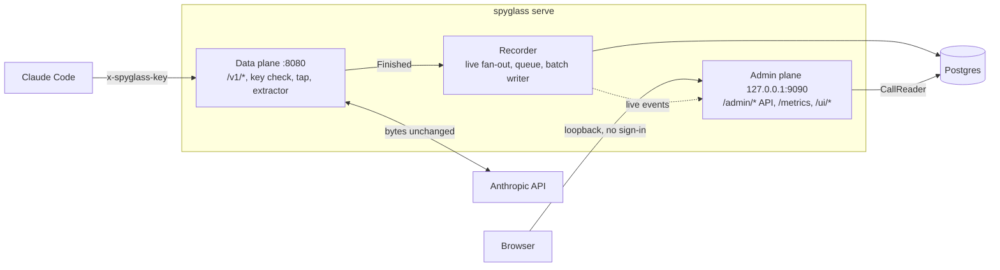
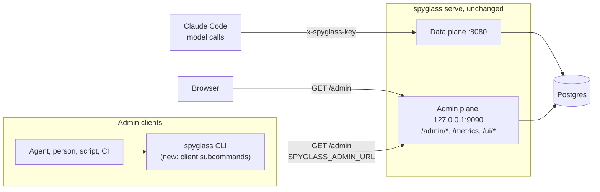
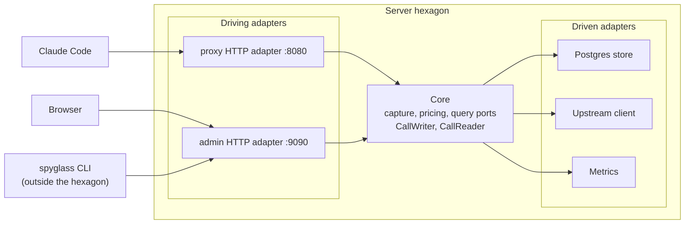
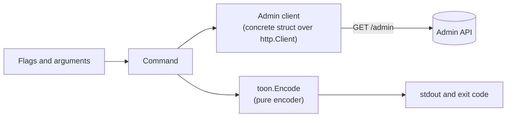

# Agent-facing CLI architecture

Status: **designed, not built.** This document describes the architecture that [ADR 0055](../adrs/0055-agent-facing-cli-axi-toon-output.md) (Status: Proposed) decides. No CLI code exists yet. Everything under "With the CLI" is a target. Everything under "Today" describes landed behaviour, as written in [backend.md](backend.md) and [deployment.md](deployment.md).

The ADR is the source for command behaviour, flags, output rules and the list of API gaps. It covers the shared decisions and phase 1. Later phases are listed in its "Later" section, and the session `unpriced_calls` field is [ADR 0056](../adrs/0056-session-unpriced-calls.md). This document gives the overall picture: what the system looks like now, what it looks like with the CLI, and what does and does not change. Where the two disagree, the ADR wins until it is Completed (see [Source precedence](README.md#source-precedence)).

## Summary

- The server does not change for the CLI itself. The same `spyglass` binary gains client subcommands. The one API addition phase 1 reads is `unpriced_calls` on the session summary (ADR 0056).
- The CLI is a read-only `GET` client of the existing `/admin` API, in the same position as the web UI.
- Output is TOON on stdout, made for agents and equally usable by people, scripts and CI.
- The CLI never touches the data plane, the database or the model-call key.
- Remote use goes through an SSH tunnel to the admin port, the same as the UI.

## Today: one process, two planes

`spyglass serve` is one process with two listeners ([backend.md, Shape](backend.md#shape)).



| Plane | Address | Who calls it | Authentication | Serves |
|---|---|---|---|---|
| Data plane | `:8080` | Claude Code and other model clients | `x-spyglass-key` virtual key, checked against the `keys` section of the config file | `/v1/*` model calls, `/healthz`, `/readyz` |
| Admin plane | `127.0.0.1:9090` | The browser | None in v1. The listener is loopback only, and `serve` refuses to start otherwise | `/admin/*` JSON API and SSE, `/metrics`, the embedded web UI at `/ui/` |

- The data plane receives a call, forwards it upstream unchanged, and records it. The capture path (tap, extractor, recorder) writes metadata rows to Postgres. Bodies are never stored.
- The admin plane reads those rows through the `CallReader` port. Sessions, agent trees, tool pairs and statistics are computed at read time.
- The web UI at `/ui/` is a JSON client of `/admin`. It has no private path to the data ([frontend.md](frontend.md)).
- The admin API is described by `api/openapi.yaml`, and the endpoints are `/admin/calls`, `/admin/sessions`, `/admin/usage`, `/admin/config`, `/admin/tool-calls` and `/admin/stream` ([backend.md, Admin and query API](backend.md#admin-and-query-api)).

An agent that wants to answer "where did the cost go?" today has only raw JSON from `curl`: large, every field of every row, and no hint what to ask next.

## With the CLI: the same server, one more client



The binary becomes both server and client, the way `docker` and `kubectl` are. The server code path is the same. Nothing new listens, nothing new is stored, and the OpenAPI document stays the contract.

### What changes and what does not

| Part | Change |
|---|---|
| `spyglass serve`, the data plane, the admin plane, the recorder, Postgres | None |
| `/admin` API and `api/openapi.yaml` | One additive field for phase 1: `unpriced_calls` on the session summary ([ADR 0056](../adrs/0056-session-unpriced-calls.md)). Other gaps could later lead to API changes, each a separate decision ([API gaps](#api-gaps-as-possible-later-server-changes)) |
| `x-spyglass-key` and the `keys` config section | None |
| `spyglass` binary | Gains client subcommands next to `serve`, `keygen` and `version`. With no arguments it now prints the home view, not usage, and `main.go` only dispatches. The binary grows by the client code and a TOON encoder |
| New internal code | Two packages: `internal/cli` (client, commands, output) and `internal/toon` (the encoder) |
| Operator setup | None for local use. Remote use needs an SSH tunnel, the same as for the UI |
| Agent setup (later) | `spyglass setup hooks` would write a Claude Code session-start hook and an agent skill. It is not part of phase 1 and has its own ADR when it starts |

### Commands

ADR 0055 gives the endpoint and parameter mapping of every phase 1 command. In short:

| Command | API used |
|---|---|
| `spyglass` (no argument: home view) | `/admin/usage` twice (ungrouped, and `group_by=session`), both with `grain=day` over the current UTC day |
| `describe` | The column tables of the commands, and `/admin/config` |
| `config` | `/admin/config` |
| `sessions list`, `sessions show <key>` | `/admin/sessions`, `/admin/sessions/{key}` |
| `calls list`, `calls show <id>` | `/admin/calls`, `/admin/calls/{id}` |

Every command is read-only, never prompts, and writes TOON to stdout. The ADR's "AXI rules applied" section lists the output rules.

Later commands are listed in the ADR's "Later" section, each with the trigger for its own ADR: `setup hooks` and an agent skill, the analysis commands (`tools summary|list`, `usage`, `top`, `compare`, `tail --for <duration>`), a per-model unpriced table, an admin key, `--json` and an MCP server.

## One key, one plane

The CLI uses no key in v1. The admin plane has no sign-in (decision C7), so the CLI sends no `Authorization` header and has no key variable. The data plane key, `x-spyglass-key`, guards model calls on `:8080`. The CLI never uses the data plane, so it never needs it.

When admin sign-in lands, the ADR for it adds one environment variable read to the client and decides the header format ([backend.md, Later versions](backend.md#gateway-features-decision-c1)). ADR 0055 reserves no name for it.

## Hexagonal view

backend.md describes the server as rings with an inward dependency rule ([Layers and the dependency rule](backend.md#layers-and-the-dependency-rule)). In ports and adapters terms:



- **Driving adapters:** the proxy HTTP adapter (`:8080`) and the admin HTTP adapter (`:9090`).
- **Core:** capture, pricing and the query ports.
- **Driven adapters:** the Postgres store, the upstream client and metrics.
- **The CLI is not a new adapter of the server.** It is another client of the admin HTTP adapter, outside the hexagon, like the browser.

### The rejected alternative: a CLI inside the hexagon

A CLI could instead call the core query ports in-process, opening Postgres itself, as a third driving adapter. ADR 0055 rejects it:

- It makes a second read path. The API's filters, time-range bounds and OpenAPI contract would be bypassed.
- The CLI would need the database password.
- It could not work through a tunnel, so a Raspberry Pi install would have no remote use.

### Inside the CLI: plain functions, no ports



Flags drive a command. The command reads through the admin client and writes through the encoder. The client is a concrete struct holding a base URL and an `*http.Client`. There is no client interface, no mock and no renderer interface. Tests use an `httptest.Server`, as the upstream client does ([backend.md](backend.md#layers-and-the-dependency-rule)). The read side has no service layer: a command maps flags to parameters, calls the client and shapes the result. A later MCP server would reuse the same client, and moving the client to its own package would then be a mechanical change. It is out of scope for ADR 0055.

## Internal pieces and the import rule

New code, all internal to the `spyglass` module, in two packages:

| Piece | Role |
|---|---|
| `internal/toon` | Pure, standard library only. An encode-only subset of TOON 3.3: objects, primitive values, arrays of scalars and tabular arrays of objects with a shared field list. Takes an explicit ordered input model (key-value pairs, field list plus rows), not reflection. Golden tests |
| `internal/cli` | One package, one file per concern. The admin client (`SPYGLASS_ADMIN_URL`, API error envelope), window parsing (`--from`, `--to`, `--since` with `m`, `h`, `d`), output helpers (window and totals header, "showing N of M", `help[]`, empty states, structured errors on stdout, `cost_micro_usd` to `cost_usd`, unpriced and API-equivalent marking) and the commands. Each command has a column table that drives default fields, `--fields`, the rename and `describe`. Exit codes: 0 success, 1 error, 2 usage error. Entry point `cli.Run` |
| `cmd/spyglass` | Dispatch only. One line per client command calls `cli.Run`. Standard library `flag`, no CLI framework (ADR 0009) |

**Decode types.** The CLI owns small decode types for the fields it reads and is checked against `api/openapi.yaml`, like the web UI. It does not import `internal/api` or `internal/config`, whose wire types are unexported and tied to the server. Tests validate the fake-server fixtures against the embedded `api.OpenAPIYAML` and check that every field the CLI reads exists in the spec.

**Import rule, checked by `depguard`.** `internal/cli` has a strict allow-list: `$gostd`, `github.com/mtanzi/spyglass/api` (the embedded spec, for tests) and `internal/toon`. It cannot import `store/postgres`, a database driver, `internal/api`, `internal/config`, `core` or a package that opens a listener. `internal/toon` allows `$gostd` only. This keeps the CLI a pure API client and keeps the "only `cmd/spyglass` wiring imports `store/postgres`" rule of [backend.md](backend.md#package-layout) meaningful. Adding the two rules to `.golangci.yml`, and the two packages to the package tree of backend.md and the layout table of `CONTRIBUTING.md`, is part of the phase 1 work.

## Connection and remote use

| Variable | Meaning |
|---|---|
| `SPYGLASS_ADMIN_URL` | Base URL of the admin listener. Default `http://127.0.0.1:9090`, the default `listen.admin` |

- No flag overrides the connection. A connection error prints the URL used and the variable that sets it.
- The admin listener stays loopback only, and the ADR does not change it.
- For a remote install, for example on a Raspberry Pi, tunnel the admin port and point the CLI at the local end, the same as for the UI ([deployment.md](deployment.md)):

```
ssh -L 9090:127.0.0.1:9090 <host>
spyglass            # now talks to the remote server through the tunnel
```

In the containerised setup the admin listener is not published, so the CLI runs on the host, or in a container that shares the host network (see [deployment.md](deployment.md)).

## Phase 1 and later

**Phase 1, orient and look up** is the only phase ADR 0055 covers: `internal/toon`, `internal/cli`, the dispatch in `cmd/spyglass`, and the commands `spyglass`, `describe`, `config`, `sessions list|show`, `calls list|show`. Tests run against a fake admin server, plus one case in the e2e suite against the real wiring.

**The home view** uses a fixed window, the current UTC day, with `grain=day` on both usage requests. Each group is then one bucket, so totals, p95 and the session ranking are exact with no extra code path. It shows the headline `unpriced_calls` and no table of models with no price.

**Later** items have a trigger and their own ADR: `setup hooks` and an agent skill, the analysis commands, the per-model unpriced table, an admin key, `--json` and an MCP server. They are listed in ADR 0055, "Later".

**No-argument behaviour changes.** Today `spyglass` with no arguments prints usage to stderr and exits 2. With the CLI it prints the home view. The container image runs `serve` explicitly, so it is not affected.

## API gaps as possible later server changes

Phase 1 works on the existing API plus the `unpriced_calls` field of [ADR 0056](../adrs/0056-session-unpriced-calls.md). The gaps in ADR 0055 are the possible later server changes. Each would be a separate API change against `api/openapi.yaml`, with its own ADR, decided only if worth it.

| # | Gap | Smallest addition, as the ADR names it | Phase 1 |
|---|---|---|---|
| 1 | Ranked usage (`top`) | `order_by` and `limit` on grouped `/admin/usage`, or a grouped single-bucket mode | Avoided: one-day window, one bucket per session |
| 2 | Models with no price | A `priced=false` filter, or `group_by=provider,model` | Not needed: headline count only |
| 3 | Exact percentiles over a window | An ungrouped single-bucket mode of `/admin/usage` | Avoided: one-day window, one bucket |
| 4 | Totals over a window (`compare`, `top`) | The same single-bucket mode | Later phases only |
| 5 | Counts for sessions and tool calls | A `count` on `/admin/sessions` and `/admin/tool-calls` | Reported as "showing N, next_page" |
| 6 | Per-agent cost | `group_by=agent` on `/admin/usage` | Later phases only |
| 7 | Unpriced calls per session | `unpriced_calls` on the session summary | Closed by ADR 0056. A `providers` field can wait |

Until a gap is closed, the CLI says what it cannot know and does not invent counts.

## Related

- [ADR 0055](../adrs/0055-agent-facing-cli-axi-toon-output.md): the decision, the command tables and the output rules.
- [ADR 0056](../adrs/0056-session-unpriced-calls.md): the `unpriced_calls` field on the session summary.
- [backend.md](backend.md): the server, its layers and the admin API.
- [frontend.md](frontend.md): the other `/admin` client.
- [deployment.md](deployment.md): listeners, the admin loopback rule and tunnelling.
