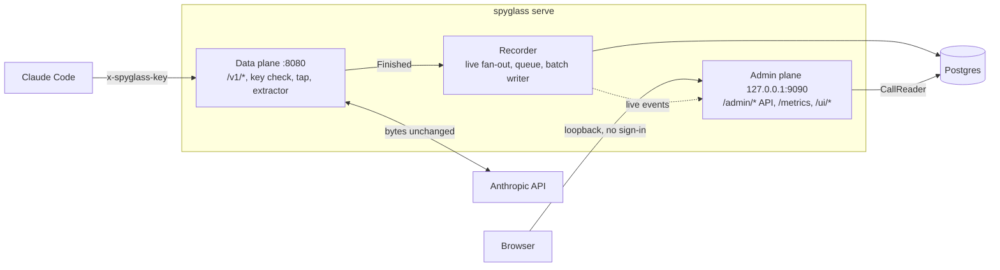
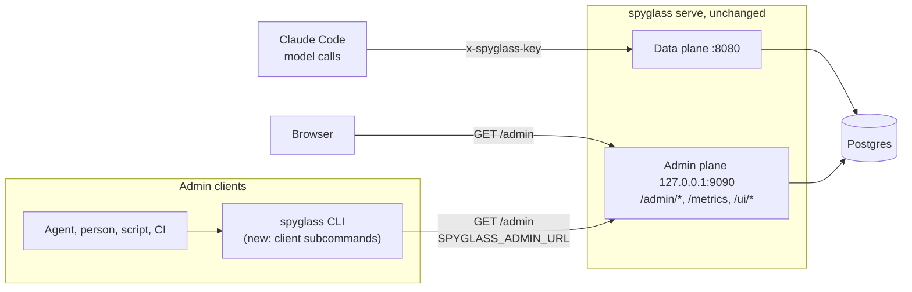
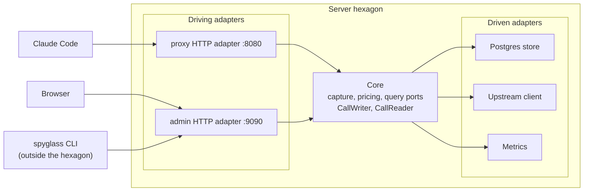
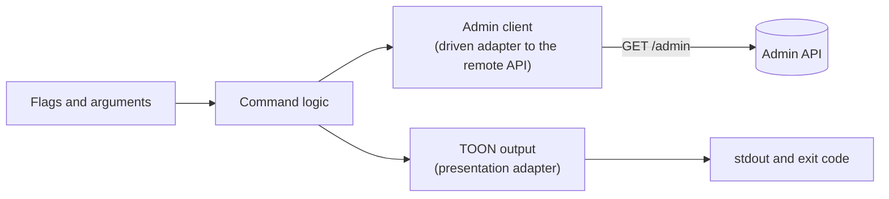

# Agent-facing CLI architecture

Status: **designed, not built.** This document describes the architecture that [ADR 0055](../adrs/0055-agent-facing-cli-axi-toon-output.md) (Status: Proposed) decides. No CLI code exists yet. Everything under "With the CLI" is a target. Everything under "Today" describes landed behaviour, as written in [backend.md](backend.md) and [deployment.md](deployment.md).

The ADR is the source for command behaviour, flags, output rules and the list of API gaps. This document gives the overall picture: what the system looks like now, what it looks like with the CLI, and what does and does not change. Where the two disagree, the ADR wins until it is Completed (see [Source precedence](README.md#source-precedence)).

## Summary

- The server does not change. The same `spyglass` binary gains client subcommands.
- The CLI is a read-only `GET` client of the existing `/admin` API, in the same position as the web UI.
- Output is TOON on stdout, made for agents and equally usable by people, scripts and CI.
- The CLI never touches the data plane, the database or the model-call key.
- Remote use goes through an SSH tunnel to the admin port, the same as the UI.

## Today: one process, two planes

`spyglass serve` is one process with two listeners ([backend.md, Shape](backend.md#shape)).



| Plane | Address | Who calls it | Authentication | Serves |
|---|---|---|---|---|
| Data plane | `:8080` | Claude Code and other model clients | `x-spyglass-key` virtual key, checked against the `keys` section of the config file | `/v1/*` model calls, `/healthz`, `/readyz` |
| Admin plane | `127.0.0.1:9090` | The browser | None in v1. The listener is loopback only, and `serve` refuses to start otherwise | `/admin/*` JSON API and SSE, `/metrics`, the embedded web UI at `/ui/` |

- The data plane receives a call, forwards it upstream unchanged, and records it. The capture path (tap, extractor, recorder) writes metadata rows to Postgres. Bodies are never stored.
- The admin plane reads those rows through the `CallReader` port. Sessions, agent trees, tool pairs and statistics are computed at read time.
- The web UI at `/ui/` is a JSON client of `/admin`. It has no private path to the data ([frontend.md](frontend.md)).
- The admin API is described by `api/openapi.yaml`, and the endpoints are `/admin/calls`, `/admin/sessions`, `/admin/usage`, `/admin/config`, `/admin/tool-calls` and `/admin/stream` ([backend.md, Admin and query API](backend.md#admin-and-query-api)).

An agent that wants to answer "where did the cost go?" today has only raw JSON from `curl`: large, every field of every row, and no hint what to ask next.

## With the CLI: the same server, one more client



The binary becomes both server and client, the way `docker` and `kubectl` are. The server code path is the same. Nothing new listens, nothing new is stored, and the OpenAPI document stays the contract.

### What changes and what does not

| Part | Change |
|---|---|
| `spyglass serve`, the data plane, the admin plane, the recorder, Postgres | None |
| `/admin` API and `api/openapi.yaml` | None in phases 1 to 3. Seven gaps could later lead to API changes, each a separate decision ([API gaps](#api-gaps-as-possible-later-server-changes)) |
| `x-spyglass-key` and the `keys` config section | None |
| `spyglass` binary | Gains client subcommands next to `serve`, `keygen` and `version`. The binary grows by the client code and a TOON encoder |
| New internal code | An admin client package, a TOON encoder, an output layer, a subcommand dispatcher |
| Operator setup | None for local use. Remote use needs an SSH tunnel, the same as for the UI |
| Agent setup (phase 2) | `spyglass setup hooks` writes a Claude Code session-start hook and an agent skill. This is the only command that writes, and it never writes to Spyglass data |

### Commands, by phase

The ADR gives the endpoint and parameter mapping of every command. In short:

| Phase | Commands | API used |
|---|---|---|
| 1: orient and look up | `spyglass` (no argument: home view), `describe`, `config`, `sessions list`, `sessions show <key>`, `calls list`, `calls show <id>` | `/admin/usage`, `/admin/config`, `/admin/sessions`, `/admin/sessions/{key}`, `/admin/calls`, `/admin/calls/{id}` |
| 2: install for an agent | `setup hooks` (with `--dry-run`, names the file first), plus a generated agent skill | None. It writes to the Claude Code settings file |
| 3: analysis | `tools summary`, `tools list`, `usage`, `top`, `compare`, `tail --for <duration>` | `/admin/tool-calls/summary`, `/admin/tool-calls`, `/admin/usage`, `/admin/stream` (time-boxed) |

Every command is read-only, never prompts, and writes TOON to stdout. The ADR's "AXI rules applied" section lists the output rules.

## Two keys, two planes

The two keys protect different planes and must not be confused.

| | `x-spyglass-key` | `SPYGLASS_ADMIN_KEY` |
|---|---|---|
| Guards | The data plane (`:8080`, model calls) | The admin plane (`:9090`) |
| State | Exists today, unchanged | Placeholder. Unset in v1 |
| Used by | Claude Code and other model clients | The CLI, once admin sign-in exists |
| Sent as | `x-spyglass-key` header | `Authorization: Bearer <key>`, only when set |
| CLI relation | The CLI never uses the data plane, so it never needs this key | Read from the environment, never accepted as a flag, never printed (the CLI shows `set` or `unset`) |

Admin sign-in does not exist in v1 (decision C7). The variable exists so the CLI does not change when sign-in lands ([backend.md, Later versions](backend.md#gateway-features-decision-c1)).

## Hexagonal view

backend.md describes the server as rings with an inward dependency rule ([Layers and the dependency rule](backend.md#layers-and-the-dependency-rule)). In ports and adapters terms:



- **Driving adapters:** the proxy HTTP adapter (`:8080`) and the admin HTTP adapter (`:9090`).
- **Core:** capture, pricing and the query ports.
- **Driven adapters:** the Postgres store, the upstream client and metrics.
- **The CLI is not a new adapter of the server.** It is another client of the admin HTTP adapter, outside the hexagon, like the browser.

### The rejected alternative: a CLI inside the hexagon

A CLI could instead call the core query ports in-process, opening Postgres itself, as a third driving adapter. ADR 0055 rejects it:

- It makes a second read path. The API's filters, time-range bounds and OpenAPI contract would be bypassed.
- The CLI would need the database password.
- It could not work through a tunnel, so a Raspberry Pi install would have no remote use.

### A small hexagon inside the CLI



Flags drive the command logic. The logic reads through the admin client and presents through the TOON output. A later optional MCP server (`spyglass mcp`, stdio) would be one more transport in this CLI hexagon, reusing the same client. It is not part of the server's hexagon and is out of scope for ADR 0055.

## Internal pieces and the import rule

New code, all internal to the `spyglass` module:

| Piece | Role |
|---|---|
| Admin client package | Resolves `SPYGLASS_ADMIN_URL` and `SPYGLASS_ADMIN_KEY`. Makes typed `GET` requests that reuse the `api` types and the API error envelope. Never prints a key |
| TOON encoder | Standard library only. Encodes objects, primitive values, arrays of scalars and tabular arrays of objects with a shared field list. Covered by golden tests |
| Output layer | Window and totals header, truncation with "showing N of M", `help[]` next-step lines, explicit empty states, structured errors on stdout, `cost_micro_usd` to `cost_usd`, unpriced and API-equivalent cost marking. Exit codes: 0 success, 1 error, 2 usage error |
| Subcommand dispatcher | In `cmd/spyglass`: the no-argument home view and the subcommands. Standard library `flag`, no CLI framework (ADR 0009) |

**Import rule: client code must not import the server's database or listener packages.** The client may use `api` types and the error envelope, and must not import `store/postgres`, a database driver, or a package that opens a listener. This keeps the CLI a pure API client and keeps the "only `cmd/spyglass` wiring imports `store/postgres`" rule of [backend.md](backend.md#package-layout) meaningful. The ADR states the rule, but backend.md's CI import check does not yet cover the client packages. Extending it is part of the phase 1 work.

## Connection and remote use

| Variable | Meaning |
|---|---|
| `SPYGLASS_ADMIN_URL` | Base URL of the admin listener. Default `http://127.0.0.1:9090`, the default `listen.admin` |
| `SPYGLASS_ADMIN_KEY` | Reserved for a future admin sign-in. Unset in v1 |

- No flag overrides the connection. A connection error prints the URL used and the variable that sets it.
- The admin listener stays loopback only, and the ADR does not change it.
- For a remote install, for example on a Raspberry Pi, tunnel the admin port and point the CLI at the local end, the same as for the UI ([deployment.md](deployment.md)):

```
ssh -L 9090:127.0.0.1:9090 <host>
spyglass            # now talks to the remote server through the tunnel
```

In the containerised setup the admin listener is not published, so the CLI runs on the host, or in a container that shares the host network (see [deployment.md](deployment.md)).

## Phases

1. **Phase 1, orient and look up:** the TOON encoder, the admin client, the output layer, the dispatcher, and the commands `spyglass`, `describe`, `config`, `sessions list|show`, `calls list|show`. Tested against a fake admin server.
2. **Phase 2, install for an agent:** `spyglass setup hooks` and a generated agent skill. The only command that writes. It names the file first, supports `--dry-run`, and is idempotent.
3. **Phase 3, analysis:** `tools summary|list`, `usage`, `top`, `compare` and `tail --for`. `tail` always has a time bound.

## API gaps as possible later server changes

Phases 1 to 3 work on the existing API, with client-side workarounds. The seven gaps in ADR 0055 are the only possible later server changes. Each would be a separate API change against `api/openapi.yaml`, with its own ADR or amendment, decided only if worth it.

| # | Gap | Smallest addition, as the ADR names it |
|---|---|---|
| 1 | Ranked usage (home view, `top`) | `order_by` and `limit` on grouped `/admin/usage`, or a grouped single-bucket mode |
| 2 | Models with no price | A `priced=false` filter, or `group_by=provider,model` |
| 3 | Exact percentiles over a window | An ungrouped single-bucket mode of `/admin/usage` |
| 4 | Totals over a window (`compare`, `top`) | The same single-bucket mode |
| 5 | Counts for sessions and tool calls | A `count` on `/admin/sessions` and `/admin/tool-calls` |
| 6 | Per-agent cost | `group_by=agent` on `/admin/usage` |
| 7 | Unpriced calls per session | `unpriced_calls` and `providers` fields on the session summary |

Until then the CLI says what it cannot know: no invented counts, `approx` marks on weighted percentiles, and a note when a window is too large to rank exactly.

## Related

- [ADR 0055](../adrs/0055-agent-facing-cli-axi-toon-output.md): the decision, the command tables and the output rules.
- [backend.md](backend.md): the server, its layers and the admin API.
- [frontend.md](frontend.md): the other `/admin` client.
- [deployment.md](deployment.md): listeners, the admin loopback rule and tunnelling.
