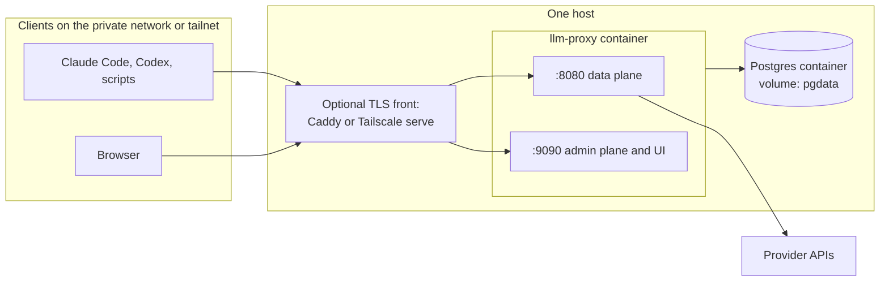
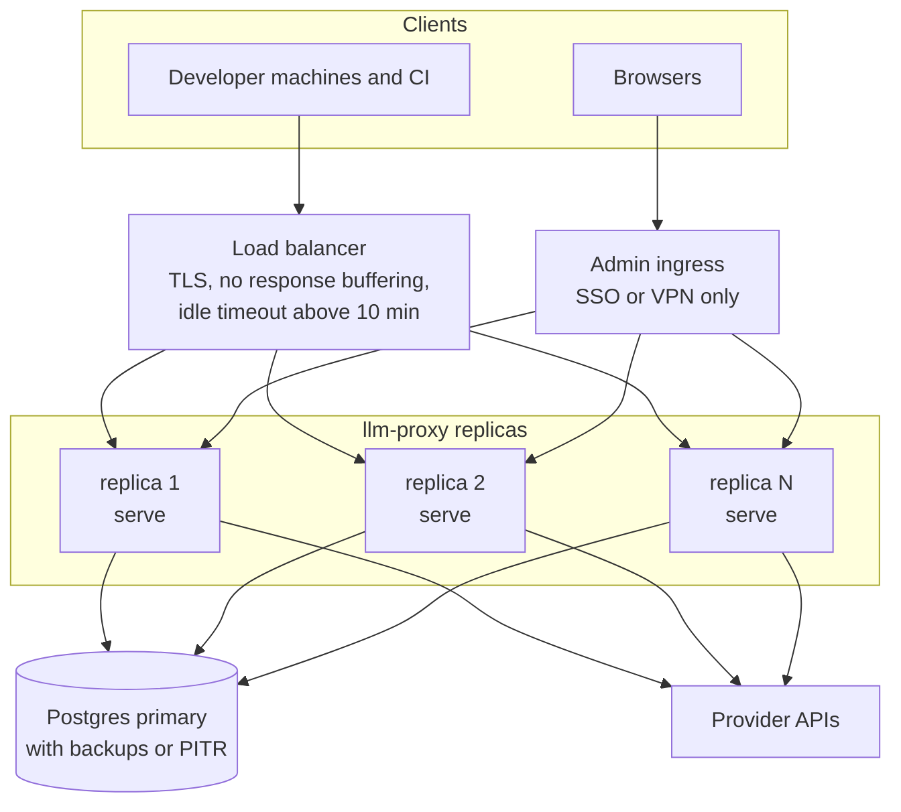

# Deployment

Part of the [architecture set](README.md). The components named here are described in [backend.md](backend.md). Provider credentials and client setup are in [upstream-connection.md](upstream-connection.md).

The design doc (7.1) names two tiers: one container plus Postgres for a home lab or small team, and stateless replicas behind a load balancer for a team or production. This document details both. v1 targets the first tier (gap review R14); the second is described so that v1 choices do not block it.

## What runs

| Piece | Form | State |
|---|---|---|
| `llm-proxy serve` | One static Go binary in a distroless container | None on disk; the call queue and caches are in memory, everything else is in the store (the `store/postgres` adapter) |
| `llm-proxy migrate up` | Same image, one-shot command | None |
| Postgres 16 or later | Separate container or managed service | Config tables, fact tables, rollups |
| Optional: reverse proxy (Caddy, a cloud load balancer) or Tailscale | In front of the listeners | TLS certificates |
| Optional: Grafana, OTLP collector | Existing observability stack | Their own |

The binary reaches storage through the store ports ([backend.md](backend.md#storage-ports-and-adapters)). v1 ships one production adapter, `store/postgres`, so Postgres is the only supported store and both tiers need it. A single-machine SQLite adapter is a possible later addition, not v1.

There is no message broker and no Redis in either tier by default. Bodies are never stored, so there is no journal and no body volume. The only buffer is the in-memory call queue, which drops and counts records when full (gap review B5; [README](README.md#resolved-decisions), D2).

## Topology A: single container (home or small team)



- One `llm-proxy` container runs everything: data plane, admin plane, batch writer and background jobs.
- Postgres runs beside it with its own volume.
- Both listeners bind to a private address. Remote access goes through a tunnel such as WireGuard or Tailscale (design doc 7.1).
- Sized for about 12,000 to 50,000 calls per day (UI report 6.1 estimates); see [Sizing](#sizing).

## Topology B: multi-replica (team or production)



- Replicas are stateless. No replica owns a volume, so any replica can be replaced, added or removed without moving data. Each replica writes its own call records straight to the shared Postgres; inserts are idempotent on the call id.
- On Kubernetes this is a plain Deployment, not a StatefulSet. On VMs, no data disk is needed.
- The load balancer must not buffer responses, must keep idle connections open longer than the longest expected stream, and needs no session affinity.
- The admin plane is exposed through a separate ingress, behind SSO or a VPN. Any replica can serve the UI.

### Shared state in the multi-replica tier

| State | Single container | Multi-replica |
|---|---|---|
| Key, alias and pricing cache | In process, refreshed by `NOTIFY` and a 30 s TTL | Same; every replica listens |
| Budget counters | In-process atomic counter per key | `budget_counters` row per key and period in Postgres, incremented asynchronously by each replica's extractor; each replica caches the value for a few seconds. Overshoot is bounded by in-flight calls times replicas (gap review B7) |
| Requests-per-minute and concurrency limits | In-process token bucket | Per-replica share of the key's limit (limit divided by replica count). Redis is the upgrade if exact limits are needed |
| Circuit breakers | In process | Per replica, accepted |
| Live tail | In-process broadcaster | `LiveFeed` port: `store/postgres` sends `NOTIFY` after each commit, relayed by every replica (**pending decision D8**) |
| Background jobs (partitions, rollups, alerts) | In process | Any replica; the adapter guards its jobs with a Postgres advisory lock per job |
| Tool-call join | One writer, ordered | Request N and N+1 can land on different replicas; the joiner runs in each replica's batch writer against Postgres and accepts either order ([backend.md](backend.md#tool-call-joiner)) |
| Derived sessions | Batch writer | Per replica; split sessions are possible when a client sends no session header. Harness headers avoid this |

## Container image

- Multi-stage build:
  1. Node stage: `npm ci && npm run build` in `web/`.
  2. Go stage: copy the UI build into `internal/ui/dist`, then `CGO_ENABLED=0 go build -trimpath -ldflags "-s -w -X main.version=…"`.
  3. Runtime stage: `gcr.io/distroless/static-debian12:nonroot`, the binary only.
- Runs as the distroless `nonroot` user (uid 65532). - Multi-arch: `linux/amd64` and `linux/arm64`.
- Entrypoint `llm-proxy`; command `serve` by default, `migrate up` for the migration job.
- Image tags follow release versions. Deployments pin a version, never `latest`.

## Configuration

One YAML file, path from `--config` or `LLM_PROXY_CONFIG`. Every key can be overridden by an environment variable named `LLM_PROXY_<SECTION>_<KEY>`. Secrets are never inlined; they are referenced by environment variable or file.

```yaml
listen:
  data: ":8080"
  admin: ":9090"
  tls:                          # optional; usually terminated in front
    cert_file: ""
    key_file: ""

database:
  url: { env: LLM_PROXY_DATABASE_URL }
  max_conns: 20

security:
  key_pepper: { file: /run/secrets/key_pepper }   # HMAC pepper for virtual keys and admin tokens
  admin_session_ttl: 12h

writer:
  queue_capacity: 10000         # call records; a full queue drops and counts
  batch_rows: 1000
  batch_interval: 500ms
  flush_timeout: 30s            # shutdown drain limit for queued records

extract:
  max_request_bytes: 32MiB      # larger requests are forwarded; their facts are marked partial
  max_event_bytes: 1MiB         # one SSE event

retention:
  requests: 400d
  request_segments: 14d
  tool_calls: 400d

server:
  drain_timeout: 10m
  max_request_bytes: 32MiB

providers:                      # pending decision D7; see upstream-connection.md
  - name: anthropic
    kind: anthropic
    base_url: https://api.anthropic.com
    auth_mode: proxy_key
    credential: { file: /run/secrets/anthropic_api_key }

otel:
  endpoint: ""                  # OTLP endpoint; empty disables span export

log:
  level: info
  format: json
```

- Virtual keys, admin tokens, aliases, routes and pricing are not in this file. They live in the store (Postgres, via `ConfigStore`) and are managed through the admin API or `llm-proxy keys`.
- `SIGHUP` reloads the file and the referenced secrets. Listener addresses need a restart.

## Secrets

| Secret | Used for | Source |
|---|---|---|
| Provider API keys | Upstream authentication in `proxy_key` mode | File (Docker or Kubernetes secret) or environment variable |
| Key pepper | HMAC of virtual keys and admin tokens | File. **Losing it invalidates every virtual key and admin token**, so back it up with the other secrets |
| Database URL and password | Postgres connection | Environment variable or file |
| Initial admin token | First sign-in | Created once with `llm-proxy keys create --admin`; printed once, never stored in plaintext |

- No secret is ever returned by the API or logged. No header value is stored in Postgres; log redaction happens in one place ([backend.md](backend.md#listener-and-router)).
- Rotation: provider keys and the database password rotate by updating the secret and sending `SIGHUP`. Virtual keys rotate through the admin API with a grace period (gap review R8).

## Migrations

- Migrations belong to the store adapter. The `store/postgres` SQL migrations live in `internal/store/postgres/migrations/`, are embedded in the binary, and are applied with goose by `llm-proxy migrate up`.
- The migration run creates the initial daily partitions.
- `serve` checks the schema version at start and refuses to run against a database that is older than it expects. It never migrates on its own.
- Every migration is **expand then contract**: a release adds columns, tables or indexes in a backward-compatible way; a later release removes what is no longer used. This keeps rolling upgrades and one-version rollbacks safe.
- Indexes on large partitioned tables are created per partition with `CREATE INDEX CONCURRENTLY`, then attached.
- Daily partition creation and dropping is done by the adapter's partition job at runtime, not by migrations.

## Storage, retention and sizing

**Decisions D1 and D2 are resolved** ([README](README.md#resolved-decisions)): bodies are never stored and call records go straight to the store. In v1 the store is the `store/postgres` adapter, and Postgres is the only store. There is no journal volume, no volume permissions to manage, no encryption-at-rest requirement for bodies and no segment retention.

- Retention is by `DROP PARTITION` on the partitioned tables, run hourly by the `store/postgres` partition job: `requests` and `request_attempts` 400 days, `request_segments` 14 days, `tool_calls` 400 days.
- Encryption of the Postgres volume follows the operator's normal policy for a database that holds usage metadata. It no longer needs to protect prompts or outputs, because none are stored.
- A normalization fix applies to new calls only. Rows already written are not recomputed, because there are no raw bytes to recompute from.
- Queue capacity bounds the data lost to a crash or a long Postgres outage (default 10,000 records, a few MB of memory). Dropped records are counted in `llm_proxy_calls_dropped_total` and raise an alert.

### Sizing

Estimates, not measurements: no live Claude Code traffic has been captured yet (UI report 2).

| Item | 12,000 calls/day | 50,000 calls/day |
|---|---|---|
| `requests` (~350 bytes/row measured in UI report 6.4) | ~1.7 GB for 400 days | ~7 GB for 400 days |
| CPU and memory for `serve` | 1 vCPU, 512 MB | 2 vCPU, 1 GB |

`request_segments` (14 days) and `tool_calls` rows add to this; they are small, metadata-only rows and have not been estimated separately. Measure the real size in the phase-1 spike and update this table.

## Backups

| Data | Importance | Home tier | Team tier |
|---|---|---|---|
| Config tables: `virtual_keys`, `admin_tokens`, `aliases`, `alias_routes`, `pricing` | High, small | Daily `pg_dump` of these tables | Covered by the full backup |
| Fact tables: `requests`, `request_attempts`, `request_segments`, `tool_calls`, rollups, alerts | Audit history (gap review N8) | Nightly full `pg_dump` | Continuous WAL archiving with point-in-time recovery (for example pgBackRest or WAL-G), plus a nightly base backup |
| Secrets, including the key pepper | Required to restore | In the secret store's own backup | Same |

Test a restore at least once per release cycle: restore Postgres, start `serve` against it, and open a recent call in the UI.

## TLS and network exposure

- The binary serves plain HTTP by default. TLS is terminated in front of it by Caddy, Tailscale (`tailscale serve`), or a cloud load balancer (gap review N2). Optional `listen.tls` serves TLS directly.
- **Data plane:** private network or tailnet. When exposed beyond that, put TLS and connection limits in front, and keep virtual-key auth on.
- **Admin plane:** never public. Bind it to localhost or a private interface; for remote use, reach it through the tailnet or an SSO-protecting reverse proxy.
- **Load balancers and reverse proxies in front of the data plane** must stream: turn off response buffering (for nginx, `proxy_buffering off`), set idle and read timeouts above the longest stream (the drain timeout of 10 minutes is a good floor), and keep HTTP/1.1 keep-alive or HTTP/2 to the backend.
- **Web application firewalls:** Anthropic's gateway docs report that WAF body rules (for example AWS WAF `CrossSiteScripting_Body`) block real Claude Code requests with an HTML `403`, because prompts contain XML-style tags and source code. Exempt `/v1/messages` from request-body inspection.
- Outbound: the container needs egress only to the configured provider base URLs, Postgres and the optional OTLP collector.

## Observability

Health endpoints, on both listeners:

| Endpoint | Data plane meaning | Admin plane meaning |
|---|---|---|
| `/healthz` | Process alive | Process alive |
| `/readyz` | Config loaded. **Not** tied to Postgres, because the data plane keeps working when Postgres is down | Postgres reachable |

During shutdown both `/readyz` endpoints report not-ready first, so the load balancer stops sending new requests while streams drain.

Prometheus metrics at `/metrics` on the admin listener:

| Metric | Watch for |
|---|---|
| `llm_proxy_requests_total{family,provider,status,error_class}` | Error rates |
| `llm_proxy_request_duration_seconds`, `llm_proxy_ttft_seconds` | Latency |
| `llm_proxy_proxy_overhead_seconds` | Added time before the first byte; target p99 under 5 ms (gap review R15) |
| `llm_proxy_inflight_streams` | Load; drain progress |
| `llm_proxy_upstream_attempts_total{provider,outcome}`, `llm_proxy_circuit_state{provider}` | Fallbacks and breaker trips |
| `llm_proxy_call_queue_depth`, `llm_proxy_calls_dropped_total{reason}` | Lost log records (should be zero) |
| `llm_proxy_writer_errors_total`, `llm_proxy_writer_lag_seconds` | Store writes (Postgres in v1) failing or falling behind |
| `llm_proxy_live_events_dropped_total` | Slow UI subscribers |

- Logs: `log/slog` JSON to stdout, one line per request with the call id. Logs never contain bodies or credentials.
- Call spans: OTLP export from the batch writer when `otel.endpoint` is set ([backend.md](backend.md#otel-export)).
- Grafana: provisioned dashboard JSON over the rollup tables for the cost and usage time series, plus a dashboard over `/metrics` for the proxy itself.
- The proxy's own alert rules (dropped calls, writer errors and lag) also appear in `GET /admin/alerts`, so the firstmate adapter sees them.

## Upgrades

Single container:

1. Read the release notes for migrations that need attention.
2. Back up Postgres (`pg_dump`).
3. Pull the new image and run `llm-proxy migrate up` with it.
4. Restart `serve`. The old process drains in-flight streams for up to `drain_timeout` before it exits; set the container stop grace period to match. Clients that lose a connection retry: Claude Code treats a cut stream as a dropped connection and retries according to its own rules.
5. The new process starts with an empty queue. Records still queued in the old process were flushed during its drain.

Multi-replica:

1. Run the migration job with the new image. Because migrations are expand-only within a release, old replicas keep working.
2. Roll replicas one at a time. Each replica gets SIGTERM, reports not-ready, drains its streams, flushes its call queue to Postgres and exits; the new replica starts fresh.
3. Contract migrations ship in a later release, after no old replica remains.

Compatibility rules:

- Rollback: the previous binary works against the expanded schema, so rolling back one release needs no database restore.

## docker-compose sketch

A starting point for topology A, not a tested file. The image is built from this repository.

```yaml
services:
  postgres:
    image: postgres:16
    environment:
      POSTGRES_DB: llmproxy
      POSTGRES_USER: llmproxy
      POSTGRES_PASSWORD_FILE: /run/secrets/pg_password
    secrets: [pg_password]
    volumes:
      - pgdata:/var/lib/postgresql/data
    healthcheck:
      test: ["CMD-SHELL", "pg_isready -U llmproxy -d llmproxy"]
      interval: 5s
      retries: 10
    restart: unless-stopped

  migrate:
    image: llm-proxy:0.1.0
    command: ["migrate", "up"]
    environment:
      LLM_PROXY_CONFIG: /etc/llm-proxy/config.yaml
      LLM_PROXY_DATABASE_URL: postgres://llmproxy@postgres:5432/llmproxy?sslmode=disable
    volumes:
      - ./config.yaml:/etc/llm-proxy/config.yaml:ro
    secrets: [pg_password]
    depends_on:
      postgres: { condition: service_healthy }
    restart: "no"

  llm-proxy:
    image: llm-proxy:0.1.0
    command: ["serve"]
    environment:
      LLM_PROXY_CONFIG: /etc/llm-proxy/config.yaml
      LLM_PROXY_DATABASE_URL: postgres://llmproxy@postgres:5432/llmproxy?sslmode=disable
    volumes:
      - ./config.yaml:/etc/llm-proxy/config.yaml:ro
    secrets: [pg_password, key_pepper, anthropic_api_key, openai_api_key]
    ports:
      - "127.0.0.1:8080:8080"   # data plane; front with Tailscale or Caddy for remote clients
      - "127.0.0.1:9090:9090"   # admin plane and UI; never bind publicly
    depends_on:
      migrate: { condition: service_completed_successfully }
    stop_grace_period: 10m       # matches server.drain_timeout
    restart: unless-stopped

volumes:
  pgdata:

secrets:
  pg_password:       { file: ./secrets/pg_password }
  key_pepper:        { file: ./secrets/key_pepper }
  anthropic_api_key: { file: ./secrets/anthropic_api_key }
  openai_api_key:    { file: ./secrets/openai_api_key }
```

Notes on the sketch:

- The database password reaches `llm-proxy` as a file; the config's `database.url` can reference it, or the URL can carry it from an environment file kept out of version control.
- `llm-proxy` mounts no data volume: it writes nothing to disk.
- After the first start, create an admin token with `docker compose exec llm-proxy llm-proxy keys create --admin`, then sign in at `http://127.0.0.1:9090/ui/`.
- Point Claude Code at `http://127.0.0.1:8080` as described in [upstream-connection.md](upstream-connection.md#claude-code-with-a-proxy-held-api-key).
