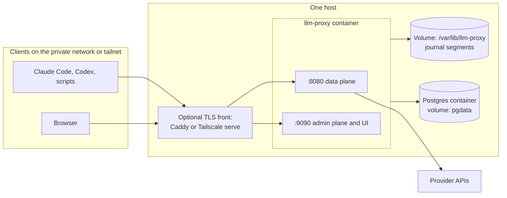
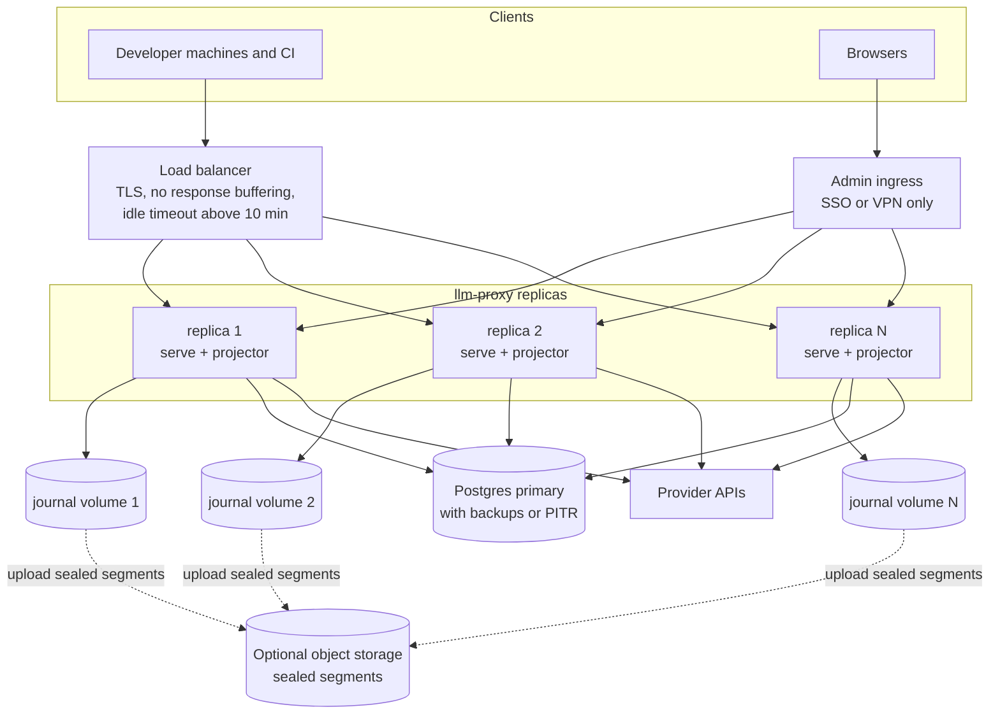

# Deployment

Part of the [architecture set](README.md). The components named here are described in [backend.md](backend.md). Provider credentials and client setup are in [upstream-connection.md](upstream-connection.md).

The design doc (7.1) names two tiers: one container plus Postgres for a home lab or small team, and stateless replicas behind a load balancer for a team or production. This document details both. v1 targets the first tier (gap review R14); the second is described so that v1 choices do not block it.

## What runs

| Piece | Form | State |
|---|---|---|
| `llm-proxy serve` | One static Go binary in a distroless container | Journal directory on a volume; everything else in memory or Postgres |
| `llm-proxy migrate up` | Same image, one-shot command | None |
| Postgres 16 or later | Separate container or managed service | Config tables, fact tables, search text, rollups |
| Optional: reverse proxy (Caddy, a cloud load balancer) or Tailscale | In front of the listeners | TLS certificates |
| Optional: Grafana, OTLP collector | Existing observability stack | Their own |

There is no message broker and no Redis in either tier by default. The journal on disk is the durable buffer (gap review B5).

## Topology A: single container (home or small team)



- One `llm-proxy` container runs everything: data plane, admin plane, journal writer, projector and background jobs.
- Postgres runs beside it with its own volume.
- Both listeners bind to a private address. Remote access goes through a tunnel such as WireGuard or Tailscale (design doc 7.1).
- Sized for about 12,000 to 50,000 calls per day (UI report 6.1 estimates); see [Sizing](#sizing).

## Topology B: multi-replica (team or production)



- Replicas are stateless for request routing, but each one owns a persistent journal volume. On Kubernetes this is a StatefulSet with one volume claim per pod; on VMs, one disk per VM. Each journal has a stable `journal_id`.
- Each replica runs its own projector over its own journal, with its own checkpoint. Projection is idempotent, so a replica can be replaced and its volume reattached without duplicate rows.
- If a journal volume can be lost (ephemeral disks), upload sealed segments to S3-compatible storage and let the projector read from there (approaches report, B5 row). This is optional when volumes are persistent.
- The load balancer must not buffer responses, must keep idle connections open longer than the longest expected stream, and needs no session affinity.
- The admin plane is exposed through a separate ingress, behind SSO or a VPN. Any replica can serve the UI.

### Shared state in the multi-replica tier

| State | Single container | Multi-replica |
|---|---|---|
| Key, alias and pricing cache | In process, refreshed by `NOTIFY` and a 30 s TTL | Same; every replica listens |
| Budget counters | In-process atomic counter per key | `budget_counters` row per key and period in Postgres, incremented asynchronously by each replica's post-stream summarizer; each replica caches the value for a few seconds. Overshoot is bounded by in-flight calls times replicas (gap review B7) |
| Requests-per-minute and concurrency limits | In-process token bucket | Per-replica share of the key's limit (limit divided by replica count). Redis is the upgrade if exact limits are needed |
| Circuit breakers | In process | Per replica, accepted |
| Live tail | In-process broadcaster | Projector `NOTIFY`, relayed by every replica (**pending decision D8**) |
| Background jobs (partitions, rollups, alerts) | In process | Any replica, guarded by a Postgres advisory lock per job |
| Tool-call join | One journal, ordered | Request N and N+1 can land on different replicas; the joiner accepts either order ([backend.md](backend.md#tool-call-joiner)) |
| Derived sessions | Projector | Per journal; split sessions are possible when a client sends no session header. Harness headers avoid this |

## Container image

- Multi-stage build:
  1. Node stage: `npm ci && npm run build` in `web/`.
  2. Go stage: copy the UI build into `internal/ui/dist`, then `CGO_ENABLED=0 go build -trimpath -ldflags "-s -w -X main.version=…"`.
  3. Runtime stage: `gcr.io/distroless/static-debian12:nonroot`, the binary only.
- Runs as the distroless `nonroot` user (uid 65532). The journal volume must be writable by that uid.
- Multi-arch: `linux/amd64` and `linux/arm64`.
- Entrypoint `llm-proxy`; command `serve` by default, `migrate up` for the migration job.
- Image tags follow release versions. Deployments pin a version, never `latest`.

## Configuration

One YAML file, path from `--config` or `LLM_PROXY_CONFIG`. Every key can be overridden by an environment variable named `LLM_PROXY_<SECTION>_<KEY>`. Secrets are never inlined; they are referenced by environment variable or file.

```yaml
listen:
  data: ":8080"
  admin: ":9090"
  tls:                          # optional; usually terminated in front
    cert_file: ""
    key_file: ""

database:
  url: { env: LLM_PROXY_DATABASE_URL }
  max_conns: 20

security:
  key_pepper: { file: /run/secrets/key_pepper }   # HMAC pepper for virtual keys and admin tokens
  admin_session_ttl: 12h

journal:
  dir: /var/lib/llm-proxy/journal
  id: ""                        # defaults to the hostname; must be stable per volume
  segment_max_bytes: 256MiB
  segment_max_age: 1h
  fsync_interval: 1s            # 0 = only on rotation
  max_exchange_bytes: 32MiB     # per direction; larger exchanges are truncated and flagged
  queue_capacity: 10000
  retention: 30d
  upload: { url: "", enabled: false }   # optional S3-compatible upload of sealed segments

capture:
  bodies_default: true          # pending decision D1; per-key override in Postgres

retention:
  requests: 400d
  request_segments: 14d
  call_text: 14d                # captain's choice
  tool_calls: 400d

server:
  drain_timeout: 10m
  max_request_bytes: 32MiB

providers:                      # pending decision D7; see upstream-connection.md
  - name: anthropic
    kind: anthropic
    base_url: https://api.anthropic.com
    auth_mode: proxy_key
    credential: { file: /run/secrets/anthropic_api_key }

projector:
  enabled: true                 # false when a separate `llm-proxy project` process runs
  batch_rows: 1000
  batch_interval: 500ms

otel:
  endpoint: ""                  # OTLP endpoint; empty disables span export
  capture_content: false

log:
  level: info
  format: json
```

- Virtual keys, admin tokens, aliases, routes and pricing are not in this file. They live in Postgres and are managed through the admin API or `llm-proxy keys`.
- `SIGHUP` reloads the file and the referenced secrets. Listener addresses and the journal directory need a restart.

## Secrets

| Secret | Used for | Source |
|---|---|---|
| Provider API keys | Upstream authentication in `proxy_key` mode | File (Docker or Kubernetes secret) or environment variable |
| Key pepper | HMAC of virtual keys and admin tokens | File. **Losing it invalidates every virtual key and admin token**, so back it up with the other secrets |
| Database URL and password | Postgres connection | Environment variable or file |
| Initial admin token | First sign-in | Created once with `llm-proxy keys create --admin`; printed once, never stored in plaintext |

- No secret is ever returned by the API, written to the journal or logged. Header redaction happens in one place ([backend.md](backend.md#capture-journal)).
- Rotation: provider keys and the database password rotate by updating the secret and sending `SIGHUP`. Virtual keys rotate through the admin API with a grace period (gap review R8).

## Migrations

- SQL migrations live in `migrations/`, are embedded in the binary, and are applied with goose by `llm-proxy migrate up`.
- The migration run creates the `pg_trgm` extension (a trusted extension since Postgres 13, so the database owner can create it) and the initial daily partitions.
- `serve` checks the schema version at start and refuses to run against a database that is older than it expects. It never migrates on its own.
- Every migration is **expand then contract**: a release adds columns, tables or indexes in a backward-compatible way; a later release removes what is no longer used. This keeps rolling upgrades and one-version rollbacks safe.
- Indexes on large partitioned tables are created per partition with `CREATE INDEX CONCURRENTLY`, then attached.
- Daily partition creation and dropping is done by the partition job at runtime, not by migrations.

## Journal storage and retention

**Pending decisions D1 (bodies on by default) and D2 (journal-first).** With D1 option (b), journal volume is much smaller for keys without body capture.

- Location: `journal.dir` on a dedicated volume. Directory `0700`, files `0600`. The volume holds prompts and outputs, so encrypt it at rest (encrypted disk or encrypted cloud volume).
- Retention: sealed segments older than `journal.retention` (default 30 days) are deleted hourly. The journal must be kept at least as long as `call_text` (14 days), so that every search hit can open its body.
- Bodies older than the journal retention are gone. Their metadata, usage, cost and tool-call rows stay in Postgres for the longer table retentions.
- Free-space guard: the writer stops accepting new records when free space falls below a threshold (default 5%), counts the drops, and raises an alert. Requests continue unaffected.
- Reprojection needs the segments, so a normalization fix reaches only history still inside the journal retention.

### Sizing

Estimates, not measurements: no live Claude Code traffic has been captured yet (UI report 2).

| Item | 12,000 calls/day | 50,000 calls/day |
|---|---|---|
| Journal (assumes ~150 KB raw per call, ~5x zstd) | ~360 MB/day, ~11 GB for 30 days | ~1.5 GB/day, ~45 GB for 30 days |
| `requests` (~350 bytes/row measured in UI report 6.4) | ~1.7 GB for 400 days | ~7 GB for 400 days |
| `call_text` for 14 days (UI report 7.4) | ~1.3 GB | ~5.5 GB |
| CPU and memory for `serve` | 1 vCPU, 512 MB | 2 vCPU, 1 GB |

Measure the real ratios in the phase-1 spike and update this table.

## Backups

| Data | Importance | Home tier | Team tier |
|---|---|---|---|
| Config tables: `virtual_keys`, `admin_tokens`, `aliases`, `alias_routes`, `pricing` | High, small | Daily `pg_dump` of these tables | Covered by the full backup |
| Fact tables: `requests`, `request_attempts`, `tool_calls`, rollups, alerts | Audit history (gap review N8) | Nightly full `pg_dump` | Continuous WAL archiving with point-in-time recovery (for example pgBackRest or WAL-G), plus a nightly base backup |
| `call_text`, `request_segments` | Rebuildable from the journal by reprojection | Not needed | Covered by the full backup |
| Journal segments | Only copy of full bodies | Optional; accept losing bodies with the disk | Upload sealed segments to object storage with a lifecycle rule equal to the journal retention |
| Secrets, including the key pepper | Required to restore | In the secret store's own backup | Same |

Test a restore at least once per release cycle: restore Postgres, start `serve` against it, and open a recent call in the UI.

## TLS and network exposure

- The binary serves plain HTTP by default. TLS is terminated in front of it by Caddy, Tailscale (`tailscale serve`), or a cloud load balancer (gap review N2). Optional `listen.tls` serves TLS directly.
- **Data plane:** private network or tailnet. When exposed beyond that, put TLS and connection limits in front, and keep virtual-key auth on.
- **Admin plane:** never public. Bind it to localhost or a private interface; for remote use, reach it through the tailnet or an SSO-protecting reverse proxy.
- **Load balancers and reverse proxies in front of the data plane** must stream: turn off response buffering (for nginx, `proxy_buffering off`), set idle and read timeouts above the longest stream (the drain timeout of 10 minutes is a good floor), and keep HTTP/1.1 keep-alive or HTTP/2 to the backend.
- **Web application firewalls:** Anthropic's gateway docs report that WAF body rules (for example AWS WAF `CrossSiteScripting_Body`) block real Claude Code requests with an HTML `403`, because prompts contain XML-style tags and source code. Exempt `/v1/messages` from request-body inspection.
- Outbound: the container needs egress only to the configured provider base URLs, Postgres, the optional object storage and the optional OTLP collector.

## Observability

Health endpoints, on both listeners:

| Endpoint | Data plane meaning | Admin plane meaning |
|---|---|---|
| `/healthz` | Process alive | Process alive |
| `/readyz` | Config loaded and journal writable. **Not** tied to Postgres, because the data plane keeps working when Postgres is down | Postgres reachable |

During shutdown both `/readyz` endpoints report not-ready first, so the load balancer stops sending new requests while streams drain.

Prometheus metrics at `/metrics` on the admin listener:

| Metric | Watch for |
|---|---|
| `llm_proxy_requests_total{family,provider,status,error_class}` | Error rates |
| `llm_proxy_request_duration_seconds`, `llm_proxy_ttft_seconds` | Latency |
| `llm_proxy_proxy_overhead_seconds` | Added time before the first byte; target p99 under 5 ms (gap review R15) |
| `llm_proxy_inflight_streams` | Load; drain progress |
| `llm_proxy_upstream_attempts_total{provider,outcome}`, `llm_proxy_circuit_state{provider}` | Fallbacks and breaker trips |
| `llm_proxy_exchange_queue_depth`, `llm_proxy_exchanges_dropped_total` | Lost log records (should be zero) |
| `llm_proxy_journal_write_errors_total`, `llm_proxy_journal_free_bytes` | Disk problems |
| `llm_proxy_projector_lag_seconds`, `llm_proxy_projector_errors_total` | Postgres falling behind |
| `llm_proxy_live_events_dropped_total` | Slow UI subscribers |

- Logs: `log/slog` JSON to stdout, one line per request with the call id. Logs never contain bodies or credentials.
- Call spans: OTLP export from the projector when `otel.endpoint` is set ([backend.md](backend.md#otel-export)).
- Grafana: provisioned dashboard JSON over the rollup tables for the cost and usage time series, plus a dashboard over `/metrics` for the proxy itself.
- The proxy's own alert rules (dropped exchanges, projector lag, journal free space) also appear in `GET /admin/alerts`, so the firstmate adapter sees them.

## Upgrades

Single container:

1. Read the release notes for migrations that need attention.
2. Back up Postgres (`pg_dump`).
3. Pull the new image and run `llm-proxy migrate up` with it.
4. Restart `serve`. The old process drains in-flight streams for up to `drain_timeout` before it exits; set the container stop grace period to match. Clients that lose a connection retry: Claude Code treats a cut stream as a dropped connection and retries according to its own rules.
5. The projector resumes from its checkpoint.

Multi-replica:

1. Run the migration job with the new image. Because migrations are expand-only within a release, old replicas keep working.
2. Roll replicas one at a time. Each replica gets SIGTERM, reports not-ready, drains its streams, seals its journal segment and exits; the new pod reattaches the same journal volume.
3. Contract migrations ship in a later release, after no old replica remains.

Compatibility rules:

- The journal record header carries a format version. New binaries read every older format; a binary never writes a format an older binary in the same rollout cannot read.
- After a release that changes normalization rules, run `llm-proxy reproject --from <segment>` to apply them to history still in the journal.
- Rollback: the previous binary works against the expanded schema, so rolling back one release needs no database restore.

## docker-compose sketch

A starting point for topology A, not a tested file. The image is built from this repository.

```yaml
services:
  postgres:
    image: postgres:16
    environment:
      POSTGRES_DB: llmproxy
      POSTGRES_USER: llmproxy
      POSTGRES_PASSWORD_FILE: /run/secrets/pg_password
    secrets: [pg_password]
    volumes:
      - pgdata:/var/lib/postgresql/data
    healthcheck:
      test: ["CMD-SHELL", "pg_isready -U llmproxy -d llmproxy"]
      interval: 5s
      retries: 10
    restart: unless-stopped

  migrate:
    image: llm-proxy:0.1.0
    command: ["migrate", "up"]
    environment:
      LLM_PROXY_CONFIG: /etc/llm-proxy/config.yaml
      LLM_PROXY_DATABASE_URL: postgres://llmproxy@postgres:5432/llmproxy?sslmode=disable
    volumes:
      - ./config.yaml:/etc/llm-proxy/config.yaml:ro
    secrets: [pg_password]
    depends_on:
      postgres: { condition: service_healthy }
    restart: "no"

  llm-proxy:
    image: llm-proxy:0.1.0
    command: ["serve"]
    environment:
      LLM_PROXY_CONFIG: /etc/llm-proxy/config.yaml
      LLM_PROXY_DATABASE_URL: postgres://llmproxy@postgres:5432/llmproxy?sslmode=disable
    volumes:
      - ./config.yaml:/etc/llm-proxy/config.yaml:ro
      - journal:/var/lib/llm-proxy
    secrets: [pg_password, key_pepper, anthropic_api_key, openai_api_key]
    ports:
      - "127.0.0.1:8080:8080"   # data plane; front with Tailscale or Caddy for remote clients
      - "127.0.0.1:9090:9090"   # admin plane and UI; never bind publicly
    depends_on:
      migrate: { condition: service_completed_successfully }
    stop_grace_period: 10m       # matches server.drain_timeout
    restart: unless-stopped

volumes:
  pgdata:
  journal:

secrets:
  pg_password:       { file: ./secrets/pg_password }
  key_pepper:        { file: ./secrets/key_pepper }
  anthropic_api_key: { file: ./secrets/anthropic_api_key }
  openai_api_key:    { file: ./secrets/openai_api_key }
```

Notes on the sketch:

- The database password reaches `llm-proxy` as a file; the config's `database.url` can reference it, or the URL can carry it from an environment file kept out of version control.
- The named `journal` volume must be writable by uid 65532. With a bind mount, `chown` the host directory first.
- After the first start, create an admin token with `docker compose exec llm-proxy llm-proxy keys create --admin`, then sign in at `http://127.0.0.1:9090/ui/`.
- Point Claude Code at `http://127.0.0.1:8080` as described in [upstream-connection.md](upstream-connection.md#claude-code-with-a-proxy-held-api-key).
