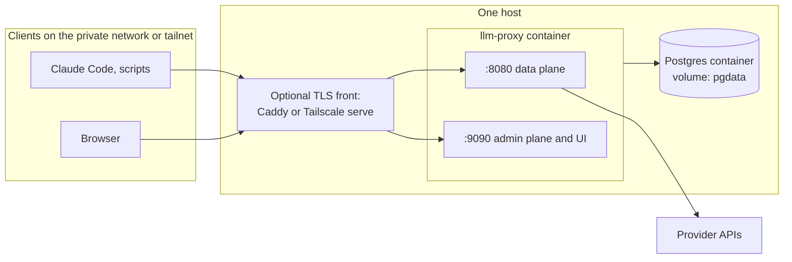

# Deployment

Part of the [architecture set](README.md). The components named here are described in [backend.md](backend.md). Provider credentials and client setup are in [upstream-connection.md](upstream-connection.md).

The design doc (7.1) names two tiers: one container plus Postgres for a home lab or small team, and stateless replicas behind a load balancer for a team or production. v1 builds the first tier (gap review R14). The second is described under [Later: multi-replica tier](#later-multi-replica-tier) so that v1 choices do not block it, but v1 builds none of its mechanisms.

## What runs

| Piece | Form | State |
|---|---|---|
| `llm-proxy serve` | One static Go binary in a distroless container. Applies its embedded migrations at start | None on disk; the call queue and the key map are in memory. Keys, providers and pricing come from the config file; call records are in the store (the `store/postgres` adapter) |
| Postgres 16 or later | Separate container or managed service | Call tables |
| Optional: reverse proxy (Caddy, a cloud load balancer) or Tailscale | In front of the listeners | TLS certificates |
| Optional: Prometheus, Grafana | Existing observability stack | Their own |

The binary reaches storage through the store ports ([backend.md](backend.md#storage-ports-and-adapters)). v1 ships one production adapter, `store/postgres`, so Postgres is the only supported store. A single-machine SQLite adapter is a possible later addition, not v1.

There is no message broker, no Redis and no separate migration container. Bodies are never stored, so there is no journal and no body volume. The only buffer is the in-memory call queue, which drops and counts records when full (gap review B5; [README](README.md#resolved-decisions), D2).

## Topology: single container (home or small team)



- One `llm-proxy` container runs everything: data plane, admin plane, recorder and the retention job.
- Postgres runs beside it with its own volume.
- The data plane binds to a private address. The admin plane has no sign-in, so it binds to loopback, and `serve` refuses to start if `listen.admin` is not a loopback address. Remote access to the data plane goes through a tunnel such as WireGuard or Tailscale (design doc 7.1).
- Sized for about 12,000 to 50,000 calls per day (UI report 6.1 estimates); see [Sizing](#sizing).

## Later: multi-replica tier

Not built in v1. The process keeps the property that makes it possible: it is stateless on disk, and every write is an idempotent insert on the call id, so a second replica could write to the same Postgres without coordination. What is missing, and what each item needs when the tier is built:

| State | v1 (one replica) | Needed for several replicas |
|---|---|---|
| Key map | In process, built from the config snapshot on start and on `SIGHUP` | Nothing: every replica reads the same config file and reloads it on `SIGHUP` |
| Live tail | In-process fan-out in `recorder` | A `LiveFeed` port: `store/postgres` sends `NOTIFY` after each commit, relayed by every replica (**pending decision D8**). In-flight calls show only on the replica that serves them |
| Retention job | One process runs it | Any replica; a Postgres advisory lock keeps it single-writer |
| Migrations | `serve` applies them at start under goose's session lock | A migration job (`--migrate=off` on replicas) when change control is strict |
| Tool-call pairing | At read time from append-only halves | Nothing: the halves are plain inserts, so either order and any replica is fine |
| Derived sessions | A pure hash, no idle state | Nothing: every replica derives the same key |
| Budgets, rate limits, circuit breakers | Deferred ([backend.md](backend.md#later-versions)) | Shared counter row, per-replica limit shares, per-replica breakers |

A load balancer in front of replicas must not buffer responses, must keep idle connections open longer than the longest expected stream, and needs no session affinity. The admin plane would need admin sign-in first ([backend.md](backend.md#gateway-features-decision-c1)), then a separate ingress behind SSO or a VPN.

## Container image

- Multi-stage build:
  1. Node stage: `npm ci && npm run build` in `web/`.
  2. Go stage: copy the UI build into `internal/ui/dist`, then `CGO_ENABLED=0 go build -trimpath -ldflags "-s -w -X main.version=…"`.
  3. Runtime stage: `gcr.io/distroless/static-debian12:nonroot`, the binary only.
- Runs as the distroless `nonroot` user (uid 65532).
- Multi-arch: `linux/amd64` and `linux/arm64`.
- Entrypoint `llm-proxy`; command `serve`.
- Image tags follow release versions. Deployments pin a version, never `latest`.

## Configuration

One YAML file, path from `--config` or `LLM_PROXY_CONFIG`. Every key can be overridden by an environment variable named `LLM_PROXY_<SECTION>_<KEY>`. Secrets are never inlined; they are referenced by environment variable or file.

```yaml
listen:
  data: ":8080"
  admin: "127.0.0.1:9090"       # must be a loopback address; serve refuses to start otherwise
  tls:                          # optional; usually terminated in front
    cert_file: ""
    key_file: ""

database:
  url: { env: LLM_PROXY_DATABASE_URL }
  max_conns: 20

providers:                      # resolved decision D7; see upstream-connection.md
  - name: anthropic
    kind: anthropic
    base_url: https://api.anthropic.com
    auth_mode: proxy_key        # proxy_key | client_passthrough | both
    credential: { file: /run/secrets/anthropic_api_key }
    idle_timeout: 120s          # idle-between-chunks watchdog

keys:                           # virtual keys: names and SHA-256 hashes, never plaintext
  - name: marco-laptop
    sha256: 9f86d081884c7d659a2feaa0c55ad015a3bf4f1b2b0b822cd15d6c15b0f00a08   # placeholder
  - name: ci
    sha256: 60303ae22b998861bce3b28f33eec1be758a213c86c93c076dbe9f558c11c752   # placeholder
    disabled: true              # revoked: requests with this key get 401

pricing:                        # versioned by effective date; placeholder prices show the shape only
  - { provider: anthropic, model: claude-opus-4-8, from: 2026-10-01,
      input: 5.00, output: 25.00, cache_read: 0.50, cache_write_5m: 6.25, cache_write_1h: 10.00 }

retention:
  calls: 400d                   # calls and tool_events

server:
  drain_timeout: 10m
  max_request_bytes: 32MiB      # the only request-size limit; larger bodies are rejected

queue_capacity: 10000           # call records; a full queue drops and counts

log:
  level: info
  format: json
```

- Providers, pricing and virtual keys are in this file and nowhere else (resolved decisions D7 and D15). The database holds call records only. A key entry has a unique `name`, the lowercase hex `sha256` of the key, and an optional `disabled: true`. A reload that finds a duplicate name, a duplicate hash or a malformed hash is rejected whole, and the proxy keeps the previous snapshot and logs the error.
- The file holds hashes, not secrets, so it can sit in version control. Anyone who can edit it can add a key and so gain access to the proxy: restrict write access as for any deploy configuration.
- Batch size and interval, the SSE event bound and the shutdown flush timeout are constants in code until measurement says otherwise. `queue_capacity` is the one writer setting.
- `SIGHUP` re-reads the file and the referenced secrets, rebuilds the key map and swaps the snapshot atomically. Requests in flight keep the snapshot they started with. This matters because a restart drains streams for up to 10 minutes. Listener addresses need a restart.

## Secrets

| Secret | Used for | Source |
|---|---|---|
| Provider API keys | Upstream authentication in `proxy_key` mode | File (Docker or Kubernetes secret) or environment variable |
| Database URL and password | Postgres connection | Environment variable or file |

- Virtual keys are not secrets of the proxy: the config file holds only their SHA-256 hashes. They are 256-bit random values, so there is no pepper and no extra secret to back up. The plaintext key lives only with the client that uses it.
- **Generate a key** outside the proxy. With the helper, `llm-proxy keygen --name marco-laptop` prints the plaintext key once (`lp_` plus base62 of 32 random bytes) and the `keys` entry to paste into the config. Without it, any 256-bit random value with the `lp_` prefix works, because the proxy hashes the presented string as is:

  ```sh
  key="lp_$(openssl rand -hex 32)"
  printf '%s' "$key" | sha256sum | cut -d' ' -f1    # on macOS: shasum -a 256
  ```

  Put the hash in the config as `sha256`, hand the key to the client, and do not keep the plaintext anywhere else. The proxy cannot show a key again.
- No secret is ever returned by the API or logged. No header value is stored in Postgres; log redaction happens in one place ([backend.md](backend.md#listener-and-router)).
- Rotation: provider keys and the database password rotate by updating the secret and sending `SIGHUP`. Virtual keys rotate by config edit: generate a new key, add its entry, send `SIGHUP`, switch the client, then set `disabled: true` on the old entry (or delete it) and send `SIGHUP` again (gap review R8). A revoked key is rejected from the next request after the reload; a stream already in flight finishes.

### Personal local setup (subscription passthrough)

Resolved decision D6: one person routes their own Claude login through their own proxy. `proxy_key` stays the default; this is the opt-in. It is for one person's own traffic, on one machine, never shared. Heavy or shared use goes through `proxy_key` with an API key. Rules and terms notes are in [upstream-connection.md](upstream-connection.md#claude-code-with-a-claude-subscription).

Generate a key (`llm-proxy keygen --name me-laptop`, or the `openssl` lines under [Secrets](#secrets)) and use a config like this:

```yaml
listen:
  data: "127.0.0.1:8080"        # loopback only
  admin: "127.0.0.1:9090"

database:
  url: { env: LLM_PROXY_DATABASE_URL }

providers:
  - name: anthropic
    kind: anthropic
    base_url: https://api.anthropic.com
    auth_mode: client_passthrough   # no provider credential: the client's own login is forwarded
    idle_timeout: 120s

keys:
  - name: me-laptop
    sha256: <hex sha256 printed by keygen>
```

Claude Code, in `~/.claude/settings.json` (not a committed project file):

```json
{
  "env": {
    "ANTHROPIC_BASE_URL": "http://127.0.0.1:8080",
    "ANTHROPIC_CUSTOM_HEADERS": "x-llm-proxy-key: lp_…",
    "CLAUDE_CODE_GATEWAY_HINT_HEADERS": "1"
  }
}
```

Do not set `ANTHROPIC_AUTH_TOKEN`, `ANTHROPIC_API_KEY` or `apiKeyHelper`; sign in with `/login`. The proxy stores no token, and the call record carries `auth_mode = oauth_passthrough` only. A call without a valid `x-llm-proxy-key` gets `401`.

## Migrations

- Migrations belong to the store adapter. The `store/postgres` SQL migrations live in `internal/store/postgres/migrations/` and are embedded in the binary.
- `serve` applies them with goose at start, under goose's session lock, before it opens the listeners. There is no separate migrate command or container.
- Every migration is **expand then contract**: a release adds columns, tables or indexes in a backward-compatible way; a later release removes what is no longer used. This keeps one-version rollbacks safe.
- Tables are not partitioned, so there is no partition creation at runtime and no per-partition index build.

## Storage, retention and sizing

**Decisions D1 and D2 are resolved** ([README](README.md#resolved-decisions)): bodies are never stored and call records go straight to the store. In v1 the store is the `store/postgres` adapter, and Postgres is the only store. There is no journal volume, no volume permissions to manage, no encryption-at-rest requirement for bodies.

- Retention is one daily job in `store/postgres`: `DELETE … WHERE ts < cutoff` in batches of 10,000 rows. `calls` and `tool_events` 400 days.
- Encryption of the Postgres volume follows the operator's normal policy for a database that holds usage metadata. It no longer needs to protect prompts or outputs, because none are stored.
- A normalization fix applies to new calls only. Rows already written are not recomputed, because there are no raw bytes to recompute from. `usage_raw` is kept on each call row so the fix can be applied to old rows where the raw usage is enough.
- Queue capacity bounds the data lost to a crash or a long Postgres outage (default 10,000 records, a few MB of memory). Dropped records are counted in `llm_proxy_calls_dropped_total`.

### Sizing

Estimates, not measurements: no live Claude Code traffic has been captured yet (UI report 2).

| Item | 12,000 calls/day | 50,000 calls/day |
|---|---|---|
| `calls` (~350 bytes/row measured in UI report 6.4, plus a few hundred bytes for the extra columns and indexes) | ~1.7 to 3 GB for 400 days | ~7 to 12 GB for 400 days |
| CPU and memory for `serve` | 1 vCPU, 512 MB | 2 vCPU, 1 GB |

At the upper end that is about 20 million `calls` rows over 400 days, 0.14 to 0.58 calls per second on average. Plain Postgres with a `(ts DESC, id DESC)` index serves a 24-hour list in milliseconds and a 30-day aggregate over about 1.5 million rows in well under a second. `tool_events` rows add to this; they are small, metadata-only rows and have not been estimated separately. Measure the real size in the phase-1 spike and update this table. Partitioning and rollups come back at the triggers in [backend.md](backend.md#storage-and-scale).

## Backups

| Data | Importance | Backup |
|---|---|---|
| `calls`, `tool_events` | Audit history (gap review N8) | Nightly full `pg_dump` |
| Config file and secrets | Required to restore (providers, pricing, virtual-key hashes, credentials). Lose the hashes and every client needs a new key | The config file in version control; secrets in the secret store's own backup |

Test a restore at least once per release cycle: restore Postgres, start `serve` against it, and open a recent call in the UI.

## TLS and network exposure

- The binary serves plain HTTP by default. TLS is terminated in front of it by Caddy, Tailscale (`tailscale serve`), or a cloud load balancer (gap review N2). Optional `listen.tls` serves TLS directly.
- **Data plane:** private network or tailnet. When exposed beyond that, put TLS and connection limits in front, and keep virtual-key auth on.
- **Admin plane:** loopback only, with no sign-in in v1. `serve` refuses to start if `listen.admin` is not a loopback address (`127.0.0.1`, `::1` or `localhost`), so it cannot be exposed by mistake. To use it from another machine, tunnel to the host, for example `ssh -L 9090:127.0.0.1:9090 <host>`. Exposing it beyond localhost, or sharing it, needs admin sign-in first ([backend.md, Later versions](backend.md#gateway-features-decision-c1)).
- **Load balancers and reverse proxies in front of the data plane** must stream: turn off response buffering (for nginx, `proxy_buffering off`), set idle and read timeouts above the longest stream (the drain timeout of 10 minutes is a good floor), and keep HTTP/1.1 keep-alive or HTTP/2 to the backend.
- **Web application firewalls:** Anthropic's gateway docs report that WAF body rules (for example AWS WAF `CrossSiteScripting_Body`) block real Claude Code requests with an HTML `403`, because prompts contain XML-style tags and source code. Exempt `/v1/messages` from request-body inspection.
- Outbound: the container needs egress only to the configured provider base URLs and Postgres.

## Observability

Health endpoints, on both listeners:

| Endpoint | Data plane meaning | Admin plane meaning |
|---|---|---|
| `/healthz` | Process alive | Process alive |
| `/readyz` | Config loaded. **Not** tied to Postgres, because the data plane keeps working when Postgres is down | Postgres reachable |

During shutdown both `/readyz` endpoints report not-ready first, so a load balancer stops sending new requests while streams drain.

Prometheus metrics at `/metrics` on the admin listener. This is a minimal set; each collector is declared in the package that updates it:

| Metric | Watch for |
|---|---|
| `llm_proxy_requests_total{family,provider,status,error_class}` | Error rates |
| `llm_proxy_request_duration_seconds`, `llm_proxy_ttft_seconds` | Latency |
| `llm_proxy_proxy_overhead_seconds` | Added time before the first byte; target p99 under 5 ms (gap review R15) |
| `llm_proxy_inflight_streams` | Load; drain progress |
| `llm_proxy_call_queue_depth`, `llm_proxy_calls_dropped_total{reason}` | Lost log records (should be zero) |
| `llm_proxy_writer_errors_total` | Store writes (Postgres in v1) failing |
| `llm_proxy_live_events_dropped_total` | Slow UI subscribers |

- Logs: `log/slog` JSON to stdout, one line per request with the call id. Logs never contain bodies or credentials.
- Dropped calls and writer errors are visible only in `/metrics` in v1. There is no alert feed; see [backend.md](backend.md#later-versions).
- Grafana dashboards over rollup tables, and OTLP span export, are deferred with rollups and OTel.

## Upgrades

1. Read the release notes for migrations that need attention.
2. Back up Postgres (`pg_dump`).
3. Pull the new image and restart `serve`. The new process applies its migrations at start. The old process drains in-flight streams for up to `drain_timeout` before it exits; set the container stop grace period to match. Clients that lose a connection retry: Claude Code treats a cut stream as a dropped connection and retries according to its own rules.
4. The new process starts with an empty queue. Records still queued in the old process were flushed during its drain.

Compatibility rules:

- Rollback: migrations are expand-only within a release, so the previous binary works against the expanded schema and rolling back one release needs no database restore.
- A config-only change (pricing, provider credentials) needs `SIGHUP`, not a restart.

## docker-compose sketch

A starting point for the single-container topology, not a tested file. The image is built from this repository.

```yaml
services:
  postgres:
    image: postgres:16
    environment:
      POSTGRES_DB: llmproxy
      POSTGRES_USER: llmproxy
      POSTGRES_PASSWORD_FILE: /run/secrets/pg_password
    secrets: [pg_password]
    volumes:
      - pgdata:/var/lib/postgresql/data
    healthcheck:
      test: ["CMD-SHELL", "pg_isready -U llmproxy -d llmproxy"]
      interval: 5s
      retries: 10
    restart: unless-stopped

  llm-proxy:
    image: llm-proxy:0.1.0
    command: ["serve"]
    environment:
      LLM_PROXY_CONFIG: /etc/llm-proxy/config.yaml
      LLM_PROXY_DATABASE_URL: postgres://llmproxy@postgres:5432/llmproxy?sslmode=disable
    volumes:
      - ./config.yaml:/etc/llm-proxy/config.yaml:ro
    secrets: [pg_password, anthropic_api_key]
    ports:
      - "127.0.0.1:8080:8080"   # data plane; front with Tailscale or Caddy for remote clients
    depends_on:
      postgres: { condition: service_healthy }
    stop_grace_period: 10m       # matches server.drain_timeout
    restart: unless-stopped

volumes:
  pgdata:

secrets:
  pg_password:       { file: ./secrets/pg_password }
  anthropic_api_key: { file: ./secrets/anthropic_api_key }
```

Notes on the sketch:

- The database password reaches `llm-proxy` as a file; the config's `database.url` can reference it, or the URL can carry it from an environment file kept out of version control.
- `llm-proxy` mounts no data volume: it writes nothing to disk. `serve` migrates the database at start, so there is no migrate service.
- Before the first start, generate a key (`llm-proxy keygen --name <name>`, or the `openssl` lines under [Secrets](#secrets)) and add its entry under `keys:` in `config.yaml`. Without a `keys` entry every data-plane request gets `401`. After later key changes, run `docker compose kill -s HUP llm-proxy`.
- The admin listener is loopback-only, so inside the container it is not reachable through a published port. To open the UI at `http://127.0.0.1:9090/ui/`, run `serve` on the host (see [Personal local setup](#personal-local-setup-subscription-passthrough)), or use the host network (`network_mode: host`, Linux) with `listen.admin: 127.0.0.1:9090`. There is no sign-in.
- Point Claude Code at `http://127.0.0.1:8080` as described in [upstream-connection.md](upstream-connection.md#claude-code-with-a-proxy-held-api-key).
