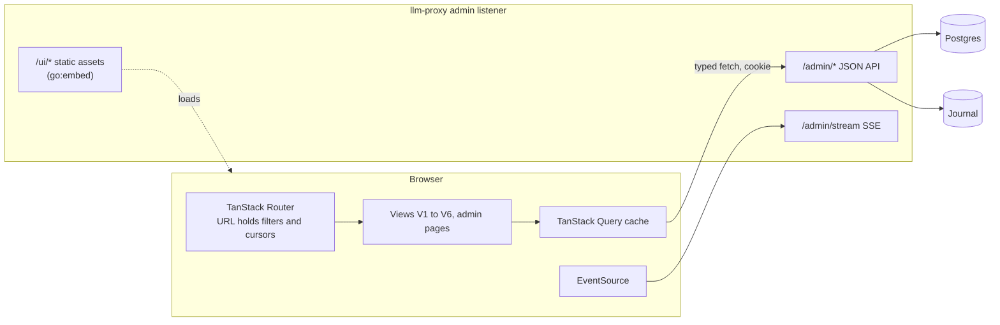

# Front-end architecture (React UI)

Part of the [architecture set](README.md). The JSON API this UI calls is specified in [backend.md](backend.md#admin-and-query-api). How the built UI ships inside the container is in [deployment.md](deployment.md).

## Decision and shape

The captain chose a **React single-page application embedded in the Go binary**, with a Go JSON API and SSE live tail (UI report section 10, Q1 option a).

- Built with Vite and React. No Next.js and no server-side rendering runtime, so the build output is static files that the Go binary embeds with `go:embed`.
- Served by the admin listener under `/ui/`. It talks only to `/admin/*` on the same origin.
- One binary, one container. Node is needed only at build time. Bifrost, a Go gateway, ships the same packaging with `//go:embed all:ui` and a React UI (UI report 8.2).



## Views

The six views come from the UI report, section 5, in priority order. The hierarchy they share is:

```
session → prompt (user turn) → agent (main or sub-agent) → LLM call → tool call
```

| View | Route | Purpose | Main API calls |
|---|---|---|---|
| V1 Call log (home) | `/ui/calls` | Paginated, filterable list of every LLM call, with a volume chart and a summary strip | `GET /admin/requests`, `GET /admin/usage`, `GET /admin/stream` |
| V2 Session list | `/ui/sessions` | One row per session: start, duration, client, key, prompts, calls, tool calls, cost, cache hit, errors, first prompt as title | `GET /admin/sessions` |
| V2 Session view | `/ui/sessions/:key` | Tree and waterfall of prompts, agents, calls and tool calls; cache strip | `GET /admin/sessions/{key}`, `…/tool-calls`, `…/cache-analysis` |
| V3 Call detail | `/ui/calls/:id` | Conversation delta with tool pairs, usage and cost, attempts, cache, headers, raw bytes | `GET /admin/requests/{id}`, `…/conversation`, `…/body`, `…/sse` |
| V4 Tool-call explorer | `/ui/tools` | Per-tool summary and a list of tool calls with filters on name, error, duration and argument text | `GET /admin/tool-calls/summary`, `GET /admin/tool-calls` |
| V5 Cost and cache | `/ui/cost` | Cost by key, model, client and session; cache hit ratio over time; misses with cause | `GET /admin/usage`, `GET /admin/requests` |
| V6 Search | `/ui/search` | One box over message text, tool arguments and tool results, with the V1 filters beside it | `GET /admin/search` |
| Admin | `/ui/admin/keys`, `/ui/admin/aliases`, `/ui/admin/providers`, `/ui/admin/pricing` | Create, rotate and revoke virtual keys; edit aliases and pricing; view providers (read-only) | `/admin/keys…`, `/admin/aliases…`, `/admin/providers`, `/admin/pricing` |

The wireframes for V1 to V4 are in UI report sections 5.1 to 5.4. Behavior that matters for the architecture:

### V1 Call log

- Columns: time, session and prompt, agent, client, model, status, latency, tokens in and out, cost, number of tool calls requested.
- A row click opens V3. A session cell opens V2.
- The filter menu covers every logged criterion: time, session, prompt, agent, agent type, request class, client, key, alias, provider, model, endpoint, status, error class, fallback happened, streamed, latency, TTFT, tokens, cost, cache hit, tool name, tool error, and body text.
- "Group by session" folds consecutive calls of a session into one row with "N turns" (Bifrost pattern), kept in the URL.
- Counts are approximate ("~1.2k matches"), never exact (UI report 6.3).
- A **Live** toggle prepends new calls from the SSE stream. See [Live tail](#live-tail).

### V2 Session view

- **Tree mode** nests prompt, then agent, then call, then tool call. A sub-agent nests under the `Task` tool call that spawned it, using the projector's inferred link and its confidence flag (backend `agents` table).
- **Time mode** is a waterfall sorted by start time, with one lane per agent, so parallel sub-agents and parallel tool calls show as concurrent bars.
- **Idle-gap compression** in both modes: gaps wider than 5% of the session collapse to a fixed marker (Langfuse's port of Sentry's approach). Agent sessions are mostly idle time, so a linear axis would hide the work.
- Each tree row shows duration, tokens, cost and an error badge.
- Compaction points (from `x-claude-code-compaction`) are drawn as a marker where the cache prefix resets.
- Collapsed by default past the latest prompts; virtualized beyond a few hundred rows.
- A cache strip at the bottom has one cell per call, coloured by cache hit ratio; a click opens the cache-analysis pair.

### V3 Call detail

Tabs: Conversation, Tools, Usage and cost, Attempts, Cache, Headers, Raw.

- **Conversation** shows the delta only: what is new in this call, plus the response. The unchanged prefix collapses to a line such as "58 earlier messages, 61k tokens cached". Each `tool_use` sits beside its `tool_result`, which may belong to the next call, with a link to that call. Thinking blocks are collapsed by default.
- **Attempts** lists each upstream try: provider, model, status, latency, fallback reason, upstream request id.
- **Cache** lists the prompt segments with prefix hashes compared to the previous call, highlights the first difference, and names the cause from design doc 5.2.
- **Raw** shows the request and response bytes as captured. A streamed response is shown as an SSE event list with relative timestamps, so TTFT and stalls are visible.

### V4 Tool-call explorer

- Summary table per tool: count, error rate, p50 and p95 duration, total time, split by agent type.
- List: time, session and agent, argument head, result head, duration. Duration shows whether it came from the header or was estimated.
- Unmatched halves (a use with no result, a result with no use) are their own filter.

### V5 Cost and cache

- In-app: top sessions by cost, cost per prompt, cost per firstmate task (key label `fm:<task-id>`), the list of cache misses with cause, and the "money lost to misses" estimate.
- Long time-series panels can also come from Grafana dashboard JSON over the rollup tables. Grafana panels link back into the UI with URLs such as `/ui/calls?model=…&from=…` (UI report 8.1).

### V6 Search

- The box accepts web-search syntax: `"quoted phrases"`, `-exclude`, `or`. A toggle switches to substring or regular-expression search on tool arguments.
- Hits list the call with a highlighted snippet. A click opens V3 scrolled to the matched block.
- The UI states the search window: 14 days (captain's choice). Older calls remain browsable by filters, but their text is not searchable.

## Routing and URL state

- **TanStack Router** with typed search parameters. Every filter, the time range, the cursor, the grouping toggle and the active tab are search parameters.
- A filtered view is therefore a shareable link. The firstmate alert adapter and Grafana data links can point at one.
- The router's search-param validation rejects unknown values, so a stale or hand-edited URL degrades to defaults instead of an error.
- The SPA is mounted at `/ui/`. The Go handler returns `index.html` for any `/ui/*` path that is not a file, so deep links and reloads work (see [Build and embedding](#build-and-embedding)).

## State and data fetching

- **Server state** lives in the TanStack Query cache, keyed by endpoint and parameters. There is no separate global store; the URL and the query cache are the state.
- **Typed client:** TypeScript types are generated from the admin API's OpenAPI document (`api/openapi.yaml`, served at `/admin/openapi.json`) with `openapi-typescript`, and requests go through a thin typed `fetch` wrapper. A change to the API that breaks the UI fails the UI's type check in CI.
- **Pagination:** lists use the keyset cursors the API returns. "Newer" and "older" replace page numbers. Infinite scroll in V1 and V4 uses `useInfiniteQuery` over `next_cursor`.
- **Caching rules:** finished calls never change, so call detail and bodies are cached without expiry for the session. List queries refetch on focus and when the live toggle is off.
- **Errors:** API errors carry a stable `type`; the UI maps them to inline messages. A `401` sends the user to the sign-in page.

## Table virtualization

- **TanStack Table** for column definitions, sorting of the loaded rows, column visibility and sizing.
- **TanStack Virtual** for row virtualization in V1, V2 (tree rows), V4 and the SSE event list in V3. Only visible rows are in the DOM, so a list of thousands of rows or a session of hundreds of calls stays responsive.
- The V2 tree and waterfall follow agent-prism's model (MIT): a flattened, virtualized list of tree rows, each with a waterfall bar on a shared, compressed time axis. Use its components if they fit, or reimplement the pattern.

## JSON and body viewers

Large bodies are the main rendering risk: a Claude Code request can hold hundreds of kilobytes of re-sent history, and a tool result can be megabytes.

- **Bounded previews.** Every text block first shows a 4 KB head, then "show all", which fetches the full block on demand with `GET /admin/requests/{id}/body?part=…&range=…`, then "download raw". The UI never builds a DOM tree for a multi-megabyte JSON document (Langfuse precedent: `LargeJsonFieldFallback`).
- **Structured JSON** (tool arguments, usage, headers) under a size threshold uses a collapsible JSON viewer component such as `react18-json-view` (used by Langfuse).
- **Large text** (file contents in tool results, raw bodies) uses CodeMirror 6, which virtualizes lines and supports search inside the block.
- **SSE event list** renders each event as a row with its relative time, virtualized.
- **Truncation** set by the tap (`truncated = true`) is shown as a notice on the block.

## Live tail

- The V1 **Live** toggle opens an `EventSource` on `/admin/stream` with the same filter parameters as the list.
- `call.started` events insert an in-flight row (spinner, elapsed time); `call.finished` replaces it with the final values.
- The client keeps at most 500 live rows and drops the oldest. Older rows remain reachable through the paginated list.
- On reconnect the browser sends `Last-Event-ID`, and the server replays the finished calls missed in between ([backend.md](backend.md#live-tail)).
- The stream is one-way, so SSE is enough; no WebSocket.
- **Multi-replica (pending decision D8):** finished calls from every replica arrive through the projector's `NOTIFY`; in-flight rows show only for the replica that served the page. The UI labels in-flight rows as "this replica".

## Search

- `GET /admin/search?q=…` with the V1 filters as extra parameters. The API combines `call_text` full-text matches with the filters in one SQL query, so filtering by key, model or agent inside search costs little.
- Substring and regular-expression mode searches `tool_calls.args_text` through `pg_trgm`.
- Results paginate with the same keyset cursor as V1.
- Snippets come from `ts_headline`, computed only for the page of hits.

## Authentication to the admin API

- The admin plane uses admin tokens with scope `admin` (read and write) or `read` (gap review R8). They are separate from virtual keys, which only work on the data plane.
- **Sign-in:** the user pastes an admin token into the sign-in page. `POST /admin/session` exchanges it for a session cookie: `HttpOnly`, `Secure` (when served over TLS), `SameSite=Strict`, path `/admin`, with an expiry (default 12 hours).
- A cookie is needed because `EventSource` cannot send an `Authorization` header. Scripts and the firstmate adapter still call the API with `Authorization: Bearer <admin token>`.
- **CSRF:** `SameSite=Strict` plus a required `X-Requested-With: llm-proxy-ui` header on every state-changing request. The API rejects cross-origin requests; there is no CORS allowance.
- **Roles in the UI:** a `read` session hides the admin pages and every write action. The server enforces scopes regardless of what the UI shows.
- Single sign-on (OIDC) is deferred. A reverse proxy with its own authentication can sit in front of the admin listener in the meantime ([deployment.md](deployment.md#tls-and-network-exposure)).
- **Content Security Policy** on `/ui/*`: `default-src 'self'`, no inline scripts, no third-party origins. Captured prompts are rendered as text, never as HTML, so a prompt that contains markup cannot run in the browser.

## Body capture and what the UI can show

**Pending decision D1** ([README](README.md#open-decisions)). These documents assume bodies are captured by default in the journal, with a per-key opt-out (recommended in the approaches report and UI report).

| View | With bodies captured | Without bodies (D1 option b, key not opted in) |
|---|---|---|
| V1 Call log | Full | Full, except the body-text filter and the tool-call count |
| V2 Session view | Full | Calls only; no tool calls, no sub-agent to `Task` links |
| V3 Call detail | Full | Usage, attempts, cache segments, headers; no conversation, no raw tab |
| V4 Tool explorer | Full | Empty for that key |
| V6 Search | Full | Not searchable |

The UI shows a "bodies not captured for this key" notice in place of the missing parts, instead of empty panels.

## Build and embedding

```
web/                          React + Vite source
├── src/
│   ├── routes/               one file per route (TanStack Router file routes)
│   ├── views/                V1 to V6 and admin pages
│   ├── components/           tables, tree, waterfall, viewers
│   ├── api/                  generated types (openapi-typescript) and the typed client
│   └── main.tsx
├── index.html
├── package.json              pinned versions, lockfile committed
└── vite.config.ts            base: '/ui/', dev proxy for /admin to :9090
internal/ui/
├── dist/                     build output, copied here by the build; not committed
└── embed.go                  //go:embed all:dist; SPA handler
```

Build steps:

1. `npm ci && npm run build` in `web/` produces `web/dist/` with content-hashed asset names.
2. The build copies `web/dist/` to `internal/ui/dist/`.
3. `go build` embeds it through `//go:embed all:dist` in `internal/ui`.

The container build runs these in a multi-stage Dockerfile ([deployment.md](deployment.md#container-image)), so Node never reaches the runtime image.

Serving rules in `internal/ui`:

- Files under `/ui/assets/` are served with `Cache-Control: public, max-age=31536000, immutable`, because their names carry a content hash.
- `index.html` is served with `Cache-Control: no-cache`, so a new release is picked up on the next load.
- Any other `/ui/*` path that is not a file returns `index.html` (client-side routing).
- A build tag `noui` replaces the embed with a stub page, for Go-only development and tests without Node.

Development: run `llm-proxy serve` locally and `npm run dev` in `web/`. Vite serves the UI with hot reload and proxies `/admin/*` to `localhost:9090`.

Dependency upkeep: npm dependencies are pinned with a committed lockfile and updated by a Dependabot-style routine. This is the main maintenance cost of choosing React over Go plus htmx (UI report 8.2).

## Schema and API gaps this UI depends on

From UI report section 9. Each is resolved in [backend.md](backend.md#data-model-changes) or the API table there.

| Gap | Needed by | Resolution |
|---|---|---|
| G1 correlation columns, text session key | V1 to V4 | `requests` gains agent, prompt, request class and compaction columns and `session_key text` |
| G2 `agents` entity and spawn link | V2 tree | `agents` table with `spawned_by_tool_call_id` and `link_confidence` |
| G3 session endpoints | V2 | `GET /admin/sessions`, `…/{key}`, `…/{key}/tool-calls`, cache analysis as a list |
| G4 body and conversation endpoints | V3 | `GET /admin/requests/{id}/body` and `…/conversation` |
| G5 random access into the journal | V3 | One zstd frame per record; `(segment, offset, length)` on `requests` |
| G6 `tool_calls` display and filter columns | V4, V1 tool filter | `tool_calls` table with `args_text`, `result_head`, `is_error`, `duration_ms`, `duration_source`, `source`, `status` |
| G7 rollup dimensions | V1 summary, V5 | Session, agent type, alias, provider and fallback dimensions |
| G8 `(ts, id)` index | V1 keyset | `requests (ts DESC, id DESC)` |
| G9 error partial index | V1 errors filter | `requests (ts DESC) WHERE error_class IS NOT NULL` |
| G10 searchable text | V6 | `call_text` with `tsvector` and GIN; `pg_trgm` on `tool_calls.args_text` |
| G11 MCP calls | V4 | MCP gateway writes `tool_calls` with `source = 'mcp'` |
| G12 bodies off by default | V3, V4, V6 | Pending decision D1 |
| G13 live event feed | V1 live tail | In-process broadcaster and `GET /admin/stream` |

## Deferred

Saved views, annotations and scores, roles beyond `admin` and `read`, OIDC sign-in, static HTML export of a session, and an OTel export to an external trace viewer such as Phoenix (UI report 8.5).
